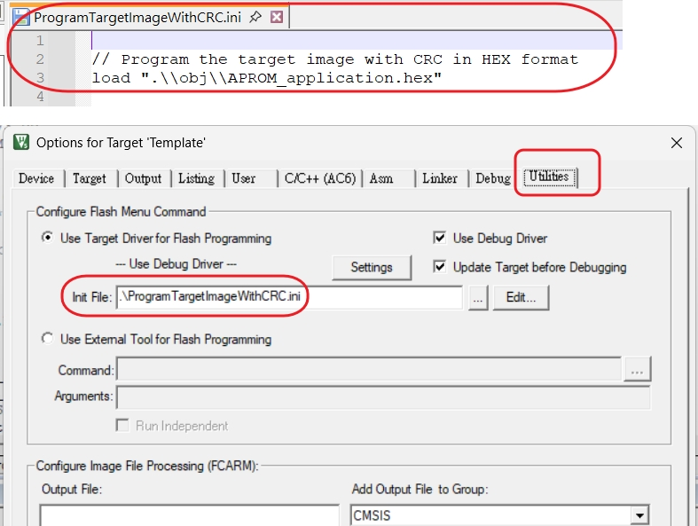
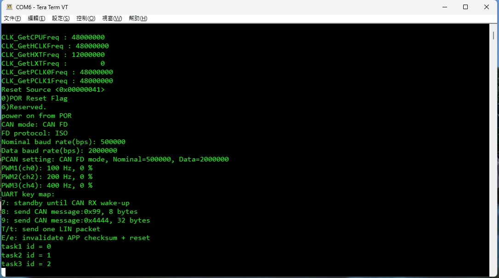
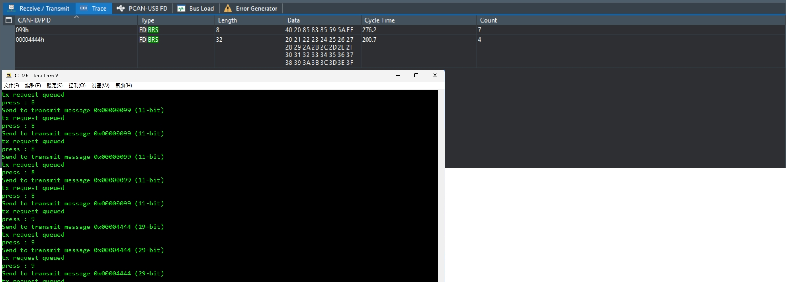
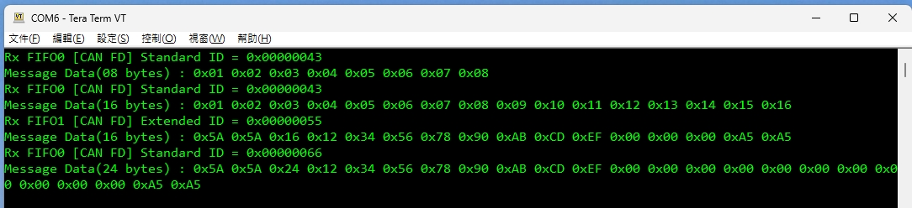
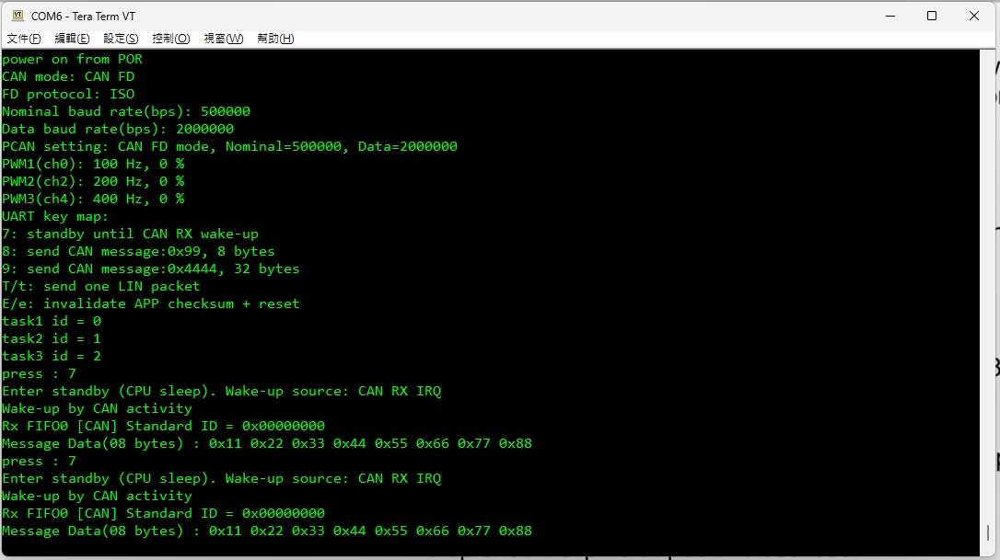
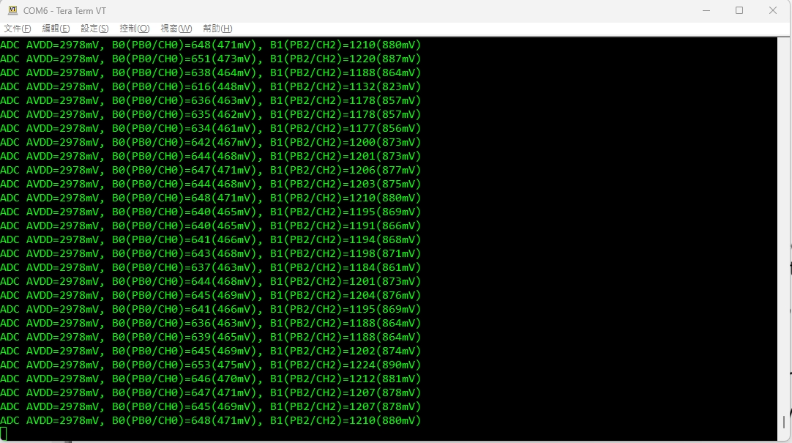
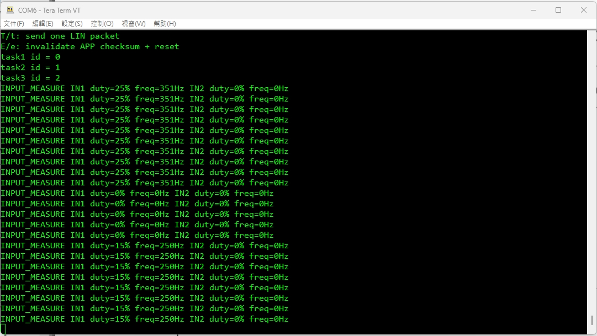
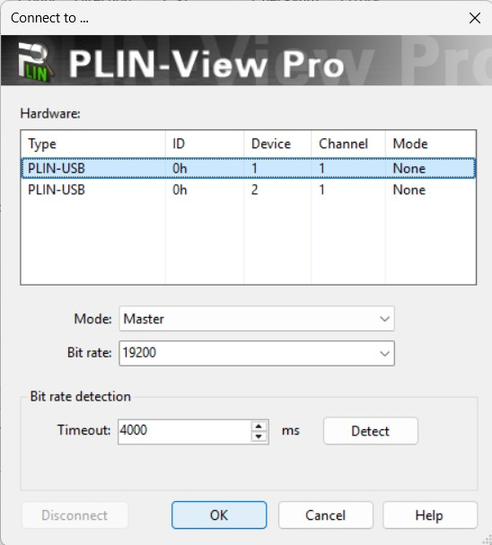
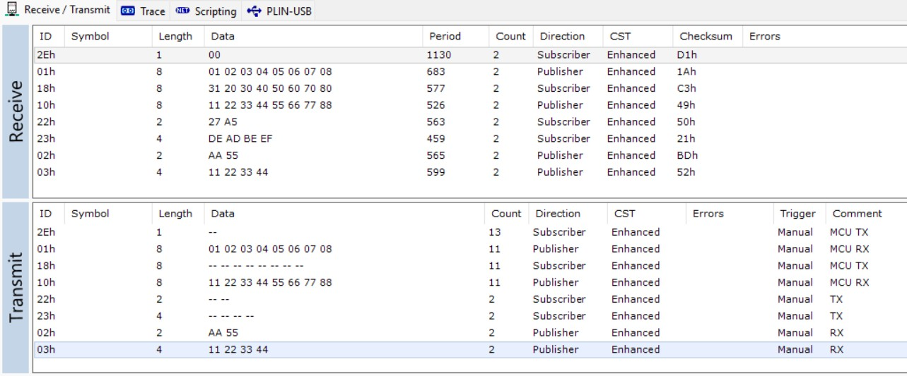
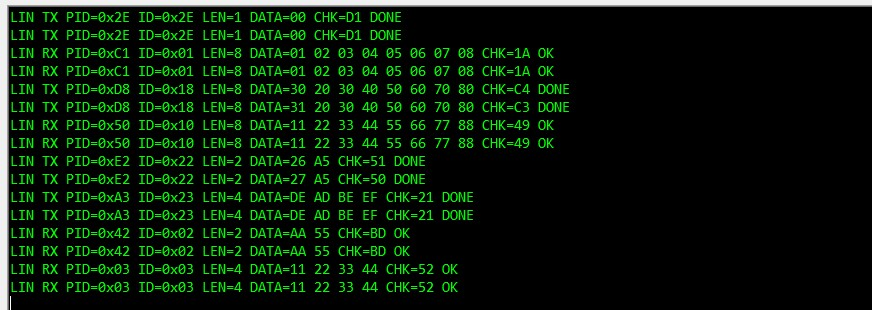

# M2A23BSP_ISP_CAN_PWM_LIN

[繁體中文](README.md) | [English](README.en.md)

M2A23 BSP example for:

- `LDROM` CAN ISP bootloader
- `APROM` application with checksum
- `CAN FD`, `PWM`, `ADC`, `GPIO input measure`
- configurable `LIN Slave` test flow

[Pin map](#pin-map) | [Build environment](#build-environment) | [CAN ISP boot](#ldrom-can-isp) | [Duty resolution](#pwm--bpwm-duty-resolution) | [LIN / PLIN](#lin-slave-path)

## Overview

- MCU / Series:
  `M2A23`
- Board:
  Pin assignments defined by this project's pin map and initialization code
- Toolchain:
  `Keil uVision5`
- Boot flow: `LDROM -> APROM` with CAN ISP.
- Image integrity: `APROM` checksum handling by `SRecord`.
- Bus functions: `CAN FD TX/RX`, CAN wake-up and LIN slave responses/reception.
- Runtime protection: `WDT` reset protection in normal run flow.
- Peripheral examples: PWM output, ADC sampling and external pulse frequency / duty measurement.

## Hardware

Pin assignments follow this project's pin map and initialization code. The NuMaker-M2A23SG schematic is only a development-board reference; this configuration does not use its `PD15` LIN sleep control or VCOM UART routing.

- Bootloader debug UART:
  `UART1`, `PB6=RXD1`, `PB7=TXD1`
- Application debug UART:
  `UART1`, `PB6=RXD1`, `PB7=TXD1`
- CAN:
  `CANFD0`, `PC4=RXD`, `PC5=TXD`
- ADC inputs:
  `PB0=ADC0_CH0`, `PB2=ADC0_CH2`
- PWM outputs:
  `PB1=PWM0_CH4`, `PB3=PWM0_CH2`, `PF5=PWM0_CH0`
- BPWM output:
  `PA3=BPWM0_CH3`, `250Hz`, default `0%`
- External pulse inputs:
  `PB5=INT0`, `PB4=INT1`
- Test equipment:
  serial terminal, CAN analyzer / PCAN, oscilloscope

## Pin Map

| Board signal | MCU pin | Peripheral / mode | Direction | Note |
| --- | --- | --- | --- | --- |
| `DBG_RX` | `PB6` | `UART1_RXD` | Input | LDROM and AP debug UART |
| `DBG_TX` | `PB7` | `UART1_TXD` | Output | LDROM and AP debug UART |
| `LIN_RX` | `PA6` | `UART0_RXD` | Input | ATA663254 RXD |
| `LIN_TX` | `PA7` | `UART0_TXD` | Output | ATA663254 TXD |
| `EN` | `PB14` | GPIO output | Output | High enables ATA663254 normal mode |
| `CANFD_RXD` | `PC4` | `CANFD0_RXD` | Input | CAN / CAN FD bus |
| `CANFD_TXD` | `PC5` | `CANFD0_TXD` | Output | CAN / CAN FD bus |
| `ADC_B0` | `PB0` | `ADC0_CH0` | Input | ADC channel B0 |
| `ADC_B1` | `PB2` | `ADC0_CH2` | Input | ADC channel B1 |
| `PWM_SET1` | `PF5` | `PWM0_CH0` | Output | PWM group 1, `100Hz` |
| `PWM_SET2` | `PB3` | `PWM0_CH2` | Output | PWM group 2, `200Hz` |
| `PWM_SET3` | `PB1` | `PWM0_CH4` | Output | PWM group 3, `400Hz` |
| `IN1_SET` | `PB5` | `INT0` | Input | Input measurement channel 1 |
| `IN2_SET` | `PB4` | `INT1` | Input | Input measurement channel 2 |
| `LED_SET1~3` | `PA0~PA2` | GPIO output | Output | GPIO output mirror |
| `LED_SET4` | `PA3` | GPIO or `BPWM0_CH3` | Output | BPWM is `250Hz`, default `0%`; selected by `DRV_GPIO_LED_SET4_GPIO_ENABLE` |
| `LED_SET5~6` | `PA4~PA5` | GPIO output | Output | GPIO output mirror |
| `SW1~SW4` | `PA15~PA12` | GPIO input | Input | Button inputs |
| `SW5~SW6` | `PC0~PC1` | GPIO input | Input | Button inputs |

When `ENABLE_LIN_SLAVE == 1`:

- AP debug UART remains on `UART1`, `PB6=RXD1`, `PB7=TXD1`
- LIN bus uses `UART0`, `PA6=RXD0`, `PA7=TXD0`

Code location:

- [main.c](SampleCode/Template/AP/main.c)

```c
#define APP_DEBUG_UART                                  UART1
#define APP_DEBUG_UART_RST                              UART1_RST
#define APP_DEBUG_UART_IRQn                             UART1_IRQn
#define APP_DEBUG_UART_IRQHandler                       UART1_IRQHandler
```

.jpg)

## Build Environment

- BSP / SDK:
  Nuvoton `M2A23` BSP
- IDE / compiler:
  `Keil uVision5`
- AP project: [SampleCode/Template/AP/Keil/Template.uvprojx](SampleCode/Template/AP/Keil/Template.uvprojx)
- ISP project: [SampleCode/Template/ISP_CAN/Keil/Template.uvprojx](SampleCode/Template/ISP_CAN/Keil/Template.uvprojx)
- LDROM output: CAN ISP bootloader image.
- APROM output: application image with CRC32 at the last 4 bytes.

## Project Layout

- AP application:
  [SampleCode/Template/AP](SampleCode/Template/AP)
- LDROM CAN ISP bootloader:
  [SampleCode/Template/ISP_CAN](SampleCode/Template/ISP_CAN)
- Memory map:
  [SampleCode/Template/memory_map.h](SampleCode/Template/memory_map.h)
- AP checksum tool:
  [SampleCode/Template/AP/Keil/checksum_config.cmd](SampleCode/Template/AP/Keil/checksum_config.cmd)
  [SampleCode/Template/AP/Keil/generateChecksum.bat](SampleCode/Template/AP/Keil/generateChecksum.bat)

## Flash Layout

Unified flash layout:

- `LDROM` holds CAN ISP bootloader
- `APROM` holds application image
- application checksum is stored at the last 4 bytes of APROM image

| Region | Address | Size | Note |
| --- | --- | --- | --- |
| `LDROM` | `0x00100000 ~ 0x00100FFF` | `4KB` | CAN ISP bootloader |
| `APROM` | `0x00000000 ~ 0x0000FFFF` | `64KB` | application image |
| `APP checksum` | `0x0000FFFC` | `4 bytes` | CRC32 at end of AP image |

Related files:

- [memory_map.h](SampleCode/Template/memory_map.h)
- [checksum_config.cmd](SampleCode/Template/AP/Keil/checksum_config.cmd)

## LDROM CAN ISP

Bootloader project:

- [SampleCode/Template/ISP_CAN/main.c](SampleCode/Template/ISP_CAN/main.c)

Behavior:

- runs in `LDROM`
- uses `Classical CAN`, `500 kbps`
- debug UART is `UART1`
- validates AP stack pointer range
- validates reset vector range and Thumb bit
- validates CRC32 at `APP_CHECKSUM_ADDR`
- if AP is valid, bootloader quickly jumps to AP
- if AP is invalid, bootloader stays in CAN ISP mode

CAN ISP IDs:

- master request ID: `0x487`
- device response ID: `0x784`

Supported command groups in current bootloader:

- read device ID
- read config word
- write APROM data
- run APROM

Programming note:

- AP image CRC is generated by post-build script
- Nu-Link programming flow can use the settings shown below



## APROM Application

Application project:

- [SampleCode/Template/AP/main.c](SampleCode/Template/AP/main.c)

Typical power-on log includes:

- clock information
- reset source
- CAN mode / baud rate
- PWM startup status
- UART key map
- timer task IDs

Image:



### UART Key Map

- `7`
  enter standby and wait for CAN RX wake-up
- `8`
  send CAN SID `0x99`, `8 bytes`
- `9`
  send CAN XID `0x4444`, `32 bytes`
- `E/e`
  invalidate APP checksum and reset
- `X/x`, `Z/z`
  reset MCU by `SYS_ResetChip()` without invalidating APP checksum

Note:

- the current target uses `drv_lin_slave.c` with `ENABLE_LIN_SLAVE = 1`
- ADC log is disabled by default: `ENABLE_ADC_LOG = 0`.
- Input measurement log is disabled by default: `ENABLE_INPUT_MEASURE_LOG = 0`.

### GPIO / BPWM Define

Related files:

- [drv_gpio_io.h](SampleCode/Template/AP/drv_gpio_io.h)
- [drv_pwm.h](SampleCode/Template/AP/drv_pwm.h)
- [drv_pwm.c](SampleCode/Template/AP/drv_pwm.c)

Current `PA3` behavior is controlled by:

```c
#define DRV_GPIO_LED_SET4_GPIO_ENABLE                   (0U)
```

PWM / BPWM driver defines:

```c
#define DRV_PWM_DUTY_RESOLUTION                         (10000U)
#define DRV_PWM_DUTY_MAX                                (DRV_PWM_DUTY_RESOLUTION)
#define DRV_PWM_GROUP1_CHANNEL                          (0U)
#define DRV_PWM_GROUP2_CHANNEL                          (2U)
#define DRV_PWM_GROUP3_CHANNEL                          (4U)
#define DRV_PWM_GROUP1_FREQ_HZ                          (100UL)
#define DRV_PWM_GROUP2_FREQ_HZ                          (200UL)
#define DRV_PWM_GROUP3_FREQ_HZ                          (400UL)
#define DRV_BPWM_CHANNEL                                (3U)
#define DRV_BPWM_FREQ_HZ                                (250UL)
```

Meaning:

- `1U`
  `PA3` stays as `LED_SET4` GPIO output
- `0U`
  `PA3` GPIO mirror is disabled
  `PA3` is switched to `BPWM0_CH3`

Current GPIO / BPWM related pin defines:

```c
#define LED_SET1                                        (PA0)
#define LED_SET2                                        (PA1)
#define LED_SET3                                        (PA2)
#define LED_SET4                                        (PA3)
#define LED_SET5                                        (PA4)
#define LED_SET6                                        (PA5)
#define SW_1                                            (PA15)
#define SW_2                                            (PA14)
#define SW_3                                            (PA13)
#define SW_4                                            (PA12)
#define SW_5                                            (PC0)
#define SW_6                                            (PC1)
```

<a id="added-bpwm-function"></a>

### BPWM Function

API:

```c
void DRV_BPWM_SetOutputDutyCycle(uint16_t u16Duty);
```

Behavior:

- output pin:
  `PA3 = BPWM0_CH3`
- output frequency:
  fixed `250Hz`
- default startup duty:
  `0%`
- when duty is `0U`:
  output is forced to logic low
- integration note:
  `PA3` must be released from `LED_SET4` GPIO mode by setting `DRV_GPIO_LED_SET4_GPIO_ENABLE = 0U`

Usage example:

```c
/* DRV_PWM_DUTY_RESOLUTION = 10000U */
DRV_BPWM_SetOutputDutyCycle(2500U); /* 25.00% */
DRV_BPWM_SetOutputDutyCycle(5000U); /* 50.00% */
DRV_BPWM_SetOutputDutyCycle(0U);
```

### PWM / BPWM Duty Resolution

Both output APIs use `uint16_t` duty values scaled by
`DRV_PWM_DUTY_RESOLUTION`. The default is `10000U` (one unit is `0.01%`).

```c
void DRV_PWM_SetOutputDutyCycle(E_DRV_PWM_GROUP eGroup, uint16_t u16Duty);
void DRV_BPWM_SetOutputDutyCycle(uint16_t u16Duty);
```

| `DRV_PWM_DUTY_RESOLUTION` | One unit | Example 1 | Example 2 | 100% input |
| --- | --- | --- | --- | --- |
| `10000U` | `0.01%` | `8230U` = `82.30%` | `4750U` = `47.50%` | `10000U` |
| `1000U` | `0.1%` | `823U` = `82.3%` | `475U` = `47.5%` | `1000U` |
| `100U` | `1%` | `82U` = `82%` | `47U` = `47%` | `100U` |

Matching API examples (select one resolution):

```c
/* #define DRV_PWM_DUTY_RESOLUTION (10000U) */
DRV_PWM_SetOutputDutyCycle(eDRV_PWM_GROUP_1, 8230U); /* 82.30% */
DRV_BPWM_SetOutputDutyCycle(4750U);                 /* 47.50% */
DRV_PWM_SetOutputDutyCycle(eDRV_PWM_GROUP_2, 8233U); /* 82.33% */

/* #define DRV_PWM_DUTY_RESOLUTION (1000U) */
DRV_PWM_SetOutputDutyCycle(eDRV_PWM_GROUP_1, 823U);  /* 82.3% */
DRV_BPWM_SetOutputDutyCycle(475U);                  /* 47.5% */

/* #define DRV_PWM_DUTY_RESOLUTION (100U) */
DRV_PWM_SetOutputDutyCycle(eDRV_PWM_GROUP_1, 82U);   /* 82% */
DRV_BPWM_SetOutputDutyCycle(47U);                   /* 47% */
```

- `DRV_PWM_DUTY_MAX` follows the resolution automatically; inputs above it are
  clamped to 100%. Other resolution values are rejected at compile time.
- Startup duty remains PWM1 `60%`, PWM2 `30%`, PWM3 `30%`, BPWM `0%` for all
  three resolutions. Output frequencies and pin assignments are unchanged.
- Input `0U` retains output masking to force logic low, rather than relying on
  a zero comparator value alone.
- The status log uses two decimal places for `10000U`, one for `1000U`, and no
  decimal places for `100U`. It reports the requested duty, not a measured value.
- Existing call sites must use matching units: `60U` means `0.60%` with the
  default `10000U`; use `6000U` for `60.00%`. Floating-point literals are not used.
- Comparator values are rounded to the nearest timer tick using 32-bit integer
  arithmetic. Actual waveform resolution depends on `CNR + 1` ticks per period;
  at least 10,000 ticks are needed for a tick step no coarser than `0.01%`.

## Main Functions

### Watchdog Timer

Behavior:

- `WDT` is enabled in AP application startup
- WDT clock source is `LIRC`
- timeout: `2^18` WDT clocks = `6.827s`
- reset delay: `18` WDT clocks = `468.75us`
- `loop()` feeds WDT once per iteration by `WDT_RESET_COUNTER()`
- before entering key `7` standby wait, application closes WDT temporarily
- after CAN wake-up, application re-initializes WDT
- reset source log will show `WDT Reset` if watchdog timeout occurs

Related code:

- [main.c](SampleCode/Template/AP/main.c)

### Timeout / Delay Reference

Current WDT timeout table:

| TOUTSEL | Timeout | Time |
| --- | ---: | ---: |
| `0000` | `2^4` | `0.417 ms` |
| `0001` | `2^6` | `1.667 ms` |
| `0010` | `2^8` | `6.667 ms` |
| `0011` | `2^10` | `26.667 ms` |
| `0100` | `2^12` | `106.667 ms` |
| `0101` | `2^14` | `426.667 ms` |
| `0110` | `2^16` | `1.707 s` |
| `0111` | `2^18` | `6.827 s` |
| `1000` | `2^20` | `27.307 s` |

Current WDT reset delay table:

| Reset delay | Time |
| ---: | ---: |
| `3 clocks` | `78.125 us` |
| `18 clocks` | `468.75 us` |
| `130 clocks` | `3.385 ms` |
| `1026 clocks` | `26.719 ms` |

### CAN FD TX / RX

CAN application driver:

- [drv_can_fd.c](SampleCode/Template/AP/drv_can_fd.c)

Behavior:

- key `8` sends SID `0x99`, `8 bytes`
- key `9` sends XID `0x4444`, `32 bytes`
- received CAN / CAN FD frames are printed on UART
- specific SID `0xBC` is parsed into `g_au8CanRxDataBC[0..7]`

#### Tx queued handling

- the three default dedicated Tx buffers are selected round-robin; a pending buffer is never overwritten
- `CAN_SendMessage()` returns `eDRV_CAN_TX_QUEUED`, `BUSY`, `BUS_OFF`, `INVALID`, or `CONTROLLER_ERROR`
- an application Tx event is cleared only after `eDRV_CAN_TX_QUEUED`; `BUSY` and `BUS_OFF` remain pending for a later loop

`eDRV_CAN_TX_QUEUED` means that the hardware accepted the request. It does not mean that another CAN node has ACKed the frame. The application should advance its transmit state only after receiving this result.

```c
E_DRV_CAN_TX_RESULT eCanTxResult;

eCanTxResult = CAN_SendMessage(TRUE, &g_sTxMsgFrame, eCANFD_SID, 0x99, 8);
eCanTxResult = CAN_SendMessage(TRUE, &g_sTxMsgFrame, eCANFD_XID, 0x4444, 32);
```

#### CAN Bus-Off recovery

- Error Warning, Error Passive, Bus-Off, arbitration/data protocol error, and Message RAM access failure interrupts are enabled
- the ISR only records status; `CAN_Process(get_tick())` logs errors and performs Bus-Off recovery in main-loop context
- recovery enters INIT, cancels pending Tx buffers, clears Restricted Operation Mode/error flags, returns to normal mode, and retries after a bounded timeout

Bus-Off bench test:

1. Make the MCU transmit while no active CAN node provides ACK, then confirm `CAN error` and `CAN Bus-Off recovery start` logs.
2. While Bus-Off is active, trigger another key `8` or `9`; this not-yet-queued event must remain pending.
3. Reconnect an active analyzer/node with matching nominal/data bitrate.
4. Confirm `CAN Bus-Off recovery completed` and that the retained event is queued afterward.

Recovery cancels hardware requests that were already pending when Bus-Off occurred. `QUEUED` is therefore not an end-to-end delivery guarantee; a protocol that requires guaranteed one-shot delivery still needs a Tx-complete/application-ACK policy.

Images:





### CAN Wake-up

Behavior:

- key `7` enters CPU idle / standby wait state
- wake-up source is CAN RX IRQ
- wake-up result is printed after CAN activity

Image:



### PWM Output

PWM driver:

- [drv_pwm.c](SampleCode/Template/AP/drv_pwm.c)

Default outputs:

- `PWM0_CH0` on `PF5`: `100Hz`, `60%`
- `PWM0_CH2` on `PB3`: `200Hz`, `30%`
- `PWM0_CH4` on `PB1`: `400Hz`, `30%`

Startup log prints all three PWM groups.

### ADC Sampling

ADC driver:

- [drv_adc.c](SampleCode/Template/AP/drv_adc.c)

Behavior:

- samples `PB0/ADC0_CH0` and `PB2/ADC0_CH2`
- moving average is updated every `10ms`
- sampling remains active when ADC logging is disabled
- when `ENABLE_ADC_LOG = 1`, `APP_ProcessADCEvents()` prints cached `AVDD`, raw
  ADC code and converted voltage in `mV` every `1000ms`

Image:



### External Pulse Measurement

GPIO input measure driver:

- [drv_gpio_io.c](SampleCode/Template/AP/drv_gpio_io.c)

Behavior:

- `PB5/INT0` measures channel 1 input pulse
- `PB4/INT1` measures channel 2 input pulse
- frequency / duty are measured from edge timestamps using `TIMER2` free-running counter
- input timeout returns channel result to `0Hz / 0%`

Current default:

- measurement remains active
- UART log is disabled by `ENABLE_INPUT_MEASURE_LOG = 0`

Reference image:



### LIN Slave Path

LIN drivers:

- [slave driver](SampleCode/Template/AP/drv_lin_slave.c)
- [master driver](SampleCode/Template/AP/drv_lin_master.c)

The drivers are separate UART0 owners and must not be compiled into the same target. The current AP target includes only `drv_lin_slave.c`; `drv_lin_master.c` is a separate driver implementation for master integration.

Node roles:

- the LIN master owns the schedule
- the M2A23 is a LIN slave
- the master sends every header (`break + sync + PID`)
- for a master-published frame, the M2A23 is the subscriber and receives the response data
- for an M2A23-published frame, the M2A23 waits for the master header and then returns only data and checksum
- the M2A23 slave does not generate master headers

Bench-test roles:

- **PLIN adapter = LIN Master**, initiating the test transactions.
- **M2A23 = LIN Slave** in every test case, whether receiving or transmitting data.
- Master/Slave determines who initiates the header. Publisher/Subscriber determines
  who sends/receives that frame's response (`Data + Checksum`). These are separate
  roles: **Publisher does not mean Master, and Subscriber does not mean Slave**.
- PLIN-View Pro's **Direction is the PLIN adapter's response-data role**, not the
  M2A23 role. With PLIN connected in Master mode, Subscriber still sends the
  header and waits for M2A23 data; Publisher sends both header and response.
- The PLIN **Transmit** list contains master-triggered transactions, including
  Subscriber headers. Its name does not mean PLIN sends the data in every row.
- All `MCU TX` / `MCU RX` labels and `LIN TX` / `LIN RX` UART logs in this example
  describe M2A23 response-data direction, not header direction.

PEAK documents header ownership separately from Publisher/Subscriber response
ownership in [PLIN-API, sections 3.5, 3.5.1 and 3.5.2](https://www.peak-system.com/produktcd/Develop/PC%20interfaces/Windows/PLIN-API/PLINAPI_enu.pdf).

Current default:

- `ENABLE_LIN_SLAVE = 1`
- the application registers each slave PID independently; no application frame table or frame count is required
- eight independently registered frames demonstrate 1-, 2-, 4- and 8-byte packets
- `LIN_SLAVE_DYNAMIC_TX_EXAMPLE = 1U` demonstrates D8/E2 payload updates every second

When enabled:

- LIN baud rate is `19200`
- Enhanced checksum is the default; Classic checksum remains selectable per frame
- UART0 hardware detects Break; the ISR then checks Sync (`0x55`) and validates and dispatches the received PID
- received data and checksum status are printed from the main loop
- LIN uses `UART0`, `PA6=RXD0`, `PA7=TXD0`
- ATA663254 `EN` is driven high through `PB14`

The eight-entry frame matrix and fixed TX response vectors are listed under
[PLIN-View Pro validation](#plin-view-pro-validation). Both endpoints are shown
there: PLIN Direction (Master) and M2A23 action (Slave).

- MCU TX: response data flows `M2A23 -> PLIN`.
- MCU RX: response data flows `PLIN -> M2A23`.
- Every header flows `PLIN -> M2A23`, including MCU TX cases.
- Data lengths exclude the checksum byte.

`0xD0` is not a valid protected identifier for ID `0x10`; the valid PID is
`0x50`. The driver rejects invalid PID parity and reports it from the main loop.
Accepting literal PID `0xD0` would be a non-standard compatibility mode and is
not enabled by this example.

Slave driver APIs:

- `DRV_LIN_SLAVE_RegisterFrame()` registers one protected PID, direction, data length and checksum mode
- `DRV_LIN_SLAVE_UnregisterFrame()` removes one PID without rebuilding an application table
- `DRV_LIN_SLAVE_Start()` starts reception after registrations and initial payload preparation
- `DRV_LIN_SLAVE_SetResponseData()` copies a publisher payload for the next matching header
- `DRV_LIN_SLAVE_GetAndClearRxPacketByPid()` retrieves only the specified RX PID's pending packet
- `DRV_LIN_SLAVE_GetAndClearTxPacket()` retrieves a completed UART response snapshot for foreground logging
- registry capacity is `DRV_LIN_SLAVE_MAX_FRAME_COUNT`, default `16U`, configurable from `1U` to `64U`
- the driver tracks the actual registration count automatically and rejects duplicate PIDs or a full registry
- register/unregister returns `DRV_LIN_SLAVE_BUSY` during a header or response; the registry is unchanged and the application may retry later
- each registration selects Classic or Enhanced checksum independently
- the default checksum macro is `DRV_LIN_SLAVE_DEFAULT_CHECKSUM_MODE`, currently Enhanced
- software PID validation rejects bad parity before lookup
- the complete-header decoder and MUTE PID filter are disabled so software receives Sync and PID from the RX FIFO
- response bytes are queued without waiting for FIFO space; TX-empty interrupts queue any remaining byte and TX-end completes the frame
- the slave never sends break, sync or PID; those header fields always come from the LIN master
- TX response buffers are independent from received frame buffers
- a newly registered publisher remains silent until its first successful payload update
- foreground updates preserve a coherent payload snapshot: a response already in progress is unchanged
- legacy `StartFrames()`, `StartReceive()` and `StartResponse()` replace the complete registry; the current application does not use them

#### Register Individual PIDs

Call `DRV_LIN_SLAVE_Init(19200U)`, then register each required PID, prepare TX
payloads and call `DRV_LIN_SLAVE_Start()` once. Registration uses the wire PID
including parity, not the PLIN 6-bit ID.

```c
DRV_LIN_SLAVE_RegisterFrame(0x2EU, eDRV_LIN_SLAVE_DIRECTION_RESPONSE,
                           1U, eDRV_LIN_SLAVE_CHECKSUM_ENHANCED);
DRV_LIN_SLAVE_RegisterFrame(0xC1U, eDRV_LIN_SLAVE_DIRECTION_RECEIVE,
                           8U, eDRV_LIN_SLAVE_CHECKSUM_ENHANCED);
DRV_LIN_SLAVE_RegisterFrame(0xD8U, eDRV_LIN_SLAVE_DIRECTION_RESPONSE,
                           8U, eDRV_LIN_SLAVE_CHECKSUM_ENHANCED);
DRV_LIN_SLAVE_RegisterFrame(0x50U, eDRV_LIN_SLAVE_DIRECTION_RECEIVE,
                           8U, eDRV_LIN_SLAVE_CHECKSUM_ENHANCED);
DRV_LIN_SLAVE_RegisterFrame(0xE2U, eDRV_LIN_SLAVE_DIRECTION_RESPONSE,
                           2U, eDRV_LIN_SLAVE_CHECKSUM_ENHANCED);
DRV_LIN_SLAVE_RegisterFrame(0xA3U, eDRV_LIN_SLAVE_DIRECTION_RESPONSE,
                           4U, eDRV_LIN_SLAVE_CHECKSUM_ENHANCED);
DRV_LIN_SLAVE_RegisterFrame(0x42U, eDRV_LIN_SLAVE_DIRECTION_RECEIVE,
                           2U, eDRV_LIN_SLAVE_CHECKSUM_ENHANCED);
DRV_LIN_SLAVE_RegisterFrame(0x03U, eDRV_LIN_SLAVE_DIRECTION_RECEIVE,
                           4U, eDRV_LIN_SLAVE_CHECKSUM_ENHANCED);
```

`APP_InitLinFrames()` in `main.c` shows return-value checks and startup ordering.

- Adding an RX PID requires its registration, matching master definition and a
  foreground receive branch with an application buffer of the matching length.
- Adding a TX PID requires its registration, matching master definition, payload
  producer and `SetResponseData()` call.
- Removing a registration stops handling that PID; the example payload updater
  skips `DRV_LIN_SLAVE_NOT_FOUND` for removed sample publishers.

To remove a PID at runtime from foreground code:

```c
DRV_LIN_SLAVE_UnregisterFrame(0xD8U);
```

An unregistered PID is ignored. To change an existing frame's direction, length
or checksum mode, unregister and register it again while idle, then prepare any
TX payload. Frame length is `1..8` data bytes, excluding checksum; the master
must use the same length and checksum type.

- For example, changing PLIN ID `0x02` to ID `0x04` changes the wire PID from
  `0x42` to `0xC4`. Update `LIN_SLAVE_PID_RECEIVE_42`'s name/value and all its
  registration/receive references consistently, then change the PLIN ID entry.
- Changing that RX example from 2 to 3 bytes requires changing the registration
  length, application buffer length and PLIN length together.
- Registration metadata is separate from payload data. Changing only a byte's
  value does not require unregistering or restarting LIN.

#### Update Payload During Operation

Compose the current data in loop code or a foreground timer callback, then
publish a complete payload. No checksum byte is supplied by the application.

```c
uint8_t au8ResponseD8[8];

au8ResponseD8[0] = 0x01U;
au8ResponseD8[1] = 0x02U;
au8ResponseD8[2] = 0x03U;
au8ResponseD8[3] = 0x04U;
au8ResponseD8[4] = 0x05U;
au8ResponseD8[5] = 0x06U;
au8ResponseD8[6] = 0x07U;
au8ResponseD8[7] = 0x08U;

DRV_LIN_SLAVE_SetResponseData(0xD8U, au8ResponseD8, 8U);
```

- The driver copies the data, so a local buffer can be reused after the call.
- Changing that local buffer alone does not update the driver; call the API again.
- Payload length must match the registration; mismatches leave the old payload unchanged.
- Updates do not send a frame immediately. The LIN master (such as PLIN) still initiates
  every header, and the driver calculates checksum from that response snapshot.
- `APP_UpdateLinResponse()` is the application packet-composition example.
  `Task_1000ms_Callback()` runs via foreground `TimerService_Dispatch()` and calls
  it after incrementing the shared D8/E2 example sequence. No application callback is run in the
  UART ISR.
- With `LIN_SLAVE_DYNAMIC_TX_EXAMPLE = 1U`, D8 byte 0 advances from `10` to `11`,
  `12`, etc. every second, wrapping as an 8-bit value. The other seven bytes stay
  `20 30 40 50 60 70 80`; `2E` continues to return data `00`.
- E2 byte 0 starts at `00` and increments every second; byte 1 stays `A5`.
  A3 stays `DE AD BE EF`. The four TX payloads are composed independently and
  do not echo or depend on an RX packet.
- Set `LIN_SLAVE_DYNAMIC_TX_EXAMPLE = 0U` to retain the initial D8/E2 test
  payloads. Custom packet producers can call `SetResponseData()` at their own
  application event or update period.

#### Process RX By PID

Each registered RX PID has its own driver mailbox. `APP_ProcessLinRx()` reads
the four RX PIDs separately from the foreground loop, then copies valid data to
independent application buffers. The per-ID branches are the application parsing
points; no application parser or log runs in the UART ISR.

| Wire PID | Application buffer | Data length |
| --- | --- | ---: |
| `0xC1` | `g_au8LinRxC1[8]` | 8 |
| `0x50` | `g_au8LinRx50[8]` | 8 |
| `0x42` | `g_au8LinRx42[2]` | 2 |
| `0x03` | `g_au8LinRx03[4]` | 4 |

Example for the two-byte PID `0x42`:

```c
S_DRV_LIN_SLAVE_PACKET sLinPacket;

if (DRV_LIN_SLAVE_GetAndClearRxPacketByPid(0x42U, &sLinPacket) != 0U)
{
    if ((sLinPacket.u8ChecksumValid != 0U) &&
        (sLinPacket.u8DataLen == sizeof(g_au8LinRx42)))
    {
        memcpy(g_au8LinRx42, sLinPacket.au8Data, sizeof(g_au8LinRx42));
        /* Process these two bytes here; other RX buffers are unchanged. */
    }
}
```

- The getter returns `1U` for a consumed packet, including a bad-checksum packet;
  `0U` means no pending packet, no such registration, a TX PID or a null output.
- The main example logs checksum errors but does not replace the application's
  last valid buffer with invalid data. Before the first valid packet, buffers
  are zero-initialized; processing occurs only in a successful receive branch.
- A pending C1 packet does not prevent receiving 50, 42 or 03. Reading one PID
  does not clear any other PID's pending packet.
- Each mailbox stores **one** pending packet, not a queue. Another completed
  packet of the same PID is dropped until the first is consumed, and
  `DRV_LIN_SLAVE_ERROR_RX_OVERFLOW` is reported. Service frequency must match the
  master schedule and foreground logging workload.
- A consumed packet is copied to caller-owned storage. Unregistering a PID
  discards its unread mailbox; initializing clears all mailboxes.
- The compatibility `GetAndClearRxPacket()` reads the first ready mailbox in
  registration order, not chronological bus order. Both getters consume the same
  mailbox; using both does not produce two copies of one event.

The system LIN matrix/LDF must define the command and feedback PIDs, frame
lengths, publishers, checksum models, schedule and timeout requirements. No
master transmit path is linked into the current application.

#### TX Completion Log

- The UART ISR records a TX event only after `TXEND`, not when a payload is
  updated or bytes are first queued. Break/error-aborted responses produce no
  completion event.
- `APP_ProcessLinTx()` runs in the main loop and prints PID, ID, length, the
  transmitted data snapshot and checksum. ISR code does not print logs.
- `DONE` means local UART transmission completed; it is not proof that the
  master received/accepted the response. PLIN reception provides the bus check.
- The event FIFO retains `DRV_LIN_SLAVE_TX_EVENT_COUNT` packets, currently 8.
  A full FIFO drops the new log event without stopping LIN TX and reports
  `LIN TX log overflow`. Each loop processes at most 8 TX log events.
- Initialization and legacy bulk restart discard unread TX events.

Example output:

```text
LIN TX PID=0x2E ID=0x2E LEN=1 DATA=00 CHK=D1 DONE
LIN TX PID=0xE2 ID=0x22 LEN=2 DATA=00 A5 CHK=77 DONE
```

#### PLIN-View Pro Validation

Common adapter settings:

- Mode: `Master`
- M2A23 node role: `Slave` (unchanged for all eight entries)
- Baud rate: `19200 bit/s`
- Trigger: `Manual` for all eight entries
- ID is the 6-bit PLIN ID; Protected ID is generated automatically, not entered
  instead of ID. Length includes data only, not checksum.

Connection settings example: select `Master` for Mode and `19200` for Bit rate.



PLIN transmit-entry settings. **Direction is configured for PLIN (Master), not
copied from the M2A23 (Slave) role.** The M2A23 action column is explanatory, not
a PLIN field.

| ID | Protected ID (auto) | Length | PLIN Direction (Master) | M2A23 action (Slave) | CST | Data entered in PLIN |
| --- | --- | ---: | --- | --- | --- | --- |
| `2Eh` | `2Eh` | 1 | Subscriber | TX / Publisher | Enhanced | Leave blank |
| `01h` | `C1h` | 8 | Publisher | RX / Subscriber | Enhanced | `01 02 03 04 05 06 07 08` |
| `18h` | `D8h` | 8 | Subscriber | TX / Publisher | Enhanced | Leave blank |
| `10h` | `50h` | 8 | Publisher | RX / Subscriber | Enhanced | `11 22 33 44 55 66 77 88` |
| `22h` | `E2h` | 2 | Subscriber | TX / Publisher | Enhanced | Leave blank |
| `23h` | `A3h` | 4 | Subscriber | TX / Publisher | Enhanced | Leave blank |
| `02h` | `42h` | 2 | Publisher | RX / Subscriber | Enhanced | `AA 55` |
| `03h` | `03h` | 4 | Publisher | RX / Subscriber | Enhanced | `11 22 33 44` |

Select one manual transmit row and press Space:

- `Subscriber`: PLIN sends a header; the MCU supplies the response. PLIN displays
  received data and MCU UART prints `LIN TX ... DONE`.
- `Publisher`: PLIN sends the header and the configured data/checksum. MCU UART
  prints `LIN RX ... OK` and updates only the corresponding valid RX buffer.
- PLIN calculates the checksum; no checksum byte is entered in Data.

- For ID `22h` / `23h`, PLIN Direction must be **Subscriber**, even though these
  are MCU **TX** tests. PLIN Data stays blank; the bytes come from M2A23.
- For ID `02h` / `03h`, PLIN Direction must be **Publisher**, even though these
  are MCU **RX** tests. Their Data fields contain the test bytes shown above.
- Suggested PLIN Comment text is `MCU TX` or `MCU RX`, matching the M2A23 action
  column. A bare `TX`/`RX` comment leaves the endpoint ambiguous.

For ID `2Eh`, Space sends a PLIN master header, then M2A23 supplies data `00` and
checksum `D1`. For ID `01h`, Space sends a PLIN master header followed by PLIN's
eight data bytes and checksum; M2A23 receives the response. Neither operation
changes the Master/Slave roles.

MCU response vectors with `LIN_SLAVE_DYNAMIC_TX_EXAMPLE = 0U`:

| PLIN ID | MCU response data | Enhanced checksum |
| --- | --- | --- |
| `2Eh` | `00` | `D1` |
| `18h` | `10 20 30 40 50 60 70 80` | `E4` |
| `22h` | `00 A5` | `77` |
| `23h` | `DE AD BE EF` | `21` |

The default dynamic macro is `1U`: ID `18h` and `22h` byte 0 changes every second
and their checksums change accordingly. ID `2Eh` and `23h` remain fixed. For the
Publisher test data above, expected Enhanced checksums are `1A` (01h), `49`
(10h), `BD` (02h) and `52` (03h).

PLIN receive/transmit example:



- The upper Receive list shows observed bus data; the lower Transmit list shows
  the settings used to initiate transactions.
- The `TX`/`RX` comments in this image refer to M2A23. PLIN settings still follow
  the Direction column.
- ID `18h` and `22h` use dynamic updates. Their displayed data/checksums depend
  on the test instant and need not match the initial fixed-response vectors.

Corresponding MCU UART log example:



- `LIN TX ... DONE`: M2A23 supplied the response and local UART transmission ended.
- `LIN RX ... OK`: M2A23 received the data and its checksum check passed.
- TX log snapshots can be compared with the PLIN Receive list; dynamic values
  must be matched to the same transaction.

To verify Classic checksum, change both the selected frame registration and the
PLIN frame checksum type to Classic. For ID `0x2E` with one data byte `00`, the
Classic checksum is `FF`; the Enhanced checksum is `D1`.

- Header parsing uses the hardware Break flag `BRKDETF`, not `SLVHDETF`, which
  indicates a complete hardware-decoded header rather than a software PID boundary.
- The slave uses the configured fixed baud rate; this path does not perform
  automatic baud-rate synchronization.
- Validate all eight cases on the target board with PLIN-View Pro; compiler and
  host state-machine tests do not establish bus timing or transceiver operation.

## Configuration

Main configuration files:

- [main.c](SampleCode/Template/AP/main.c)
- [drv_lin_slave.h](SampleCode/Template/AP/drv_lin_slave.h)
- [memory_map.h](SampleCode/Template/memory_map.h)

Important macros:

```c
#define ENABLE_LIN_SLAVE                (1U)
#define ENABLE_ADC_LOG                  (0U)
#define ENABLE_INPUT_MEASURE_LOG        (0U)
#define APP_CHECKSUM_ADDR               (APP_END_ADDR - 4UL)
/* WDT is enabled in code by WDT_Init() */
```

Debug UART selection:

- LDROM and AP debug use `UART1`, `PB6=RXD1`, `PB7=TXD1`
- `UART0`, `PA6=RXD0`, `PA7=TXD0` are reserved for LIN when `ENABLE_LIN_SLAVE == 1`

## Test Flow

1. Build and program LDROM bootloader and APROM application.
2. Open UART terminal for boot or app log.
3. Connect CAN analyzer to `CANFD0`.
4. Power on or reset MCU.
5. Confirm power-on log, PWM status, and key map.
6. Trigger key `8` / `9` / `7` and confirm expected CAN behavior.
7. If WDT behavior is under test, temporarily stop feeding `WDT_RESET_COUNTER()` and confirm watchdog reset after about `6.827s`.
8. If ADC or pulse input is under test, inject analog / digital signal and compare UART log with scope or meter.

## Validation

| Observation | Expected behavior |
| --- | --- |
| UART | Power-on, CAN RX/TX, wake-up and WDT reset-source logs; ADC log when enabled |
| CAN analyzer / PCAN | Configured IDs and payloads |
| PLIN-View Pro | Matching responses/reception for the eight LIN cases and no frame errors |
| Oscilloscope | PWM `100Hz`, `200Hz`, `400Hz`; BPWM `250Hz`; analog voltage and input pulses |

## Related Files

- [AP main](SampleCode/Template/AP/main.c)
- [ISP main](SampleCode/Template/ISP_CAN/main.c)
- [ADC driver](SampleCode/Template/AP/drv_adc.c)
- [PWM driver](SampleCode/Template/AP/drv_pwm.c)
- [GPIO input measure driver](SampleCode/Template/AP/drv_gpio_io.c)
- [CAN driver](SampleCode/Template/AP/drv_can_fd.c)
- [LIN slave driver](SampleCode/Template/AP/drv_lin_slave.c)
- [LIN master driver](SampleCode/Template/AP/drv_lin_master.c)
- [AP project file](SampleCode/Template/AP/Keil/Template.uvprojx)
- [ISP project file](SampleCode/Template/ISP_CAN/Keil/Template.uvprojx)

## Notes

- AP debug UART remains on `UART1`, `PB6/PB7`, when LIN is enabled.
- `AVDD` is currently calculated once during ADC init and reused in later ADC log output.
- Input measure function is active even when its UART log is disabled.
- CAN wake-up is based on CAN RX interrupt, not UART key input after entering standby.
- WDT is intentionally closed before standby wait and re-opened after CAN wake-up.
