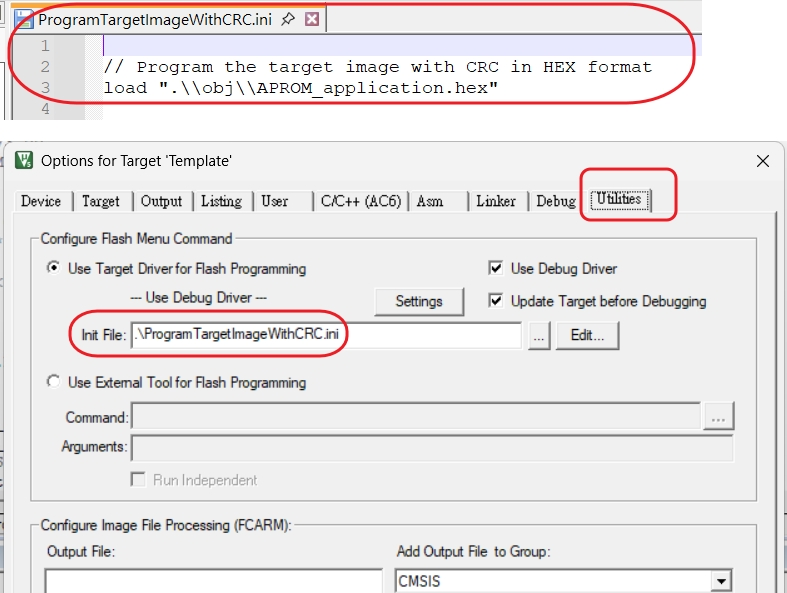
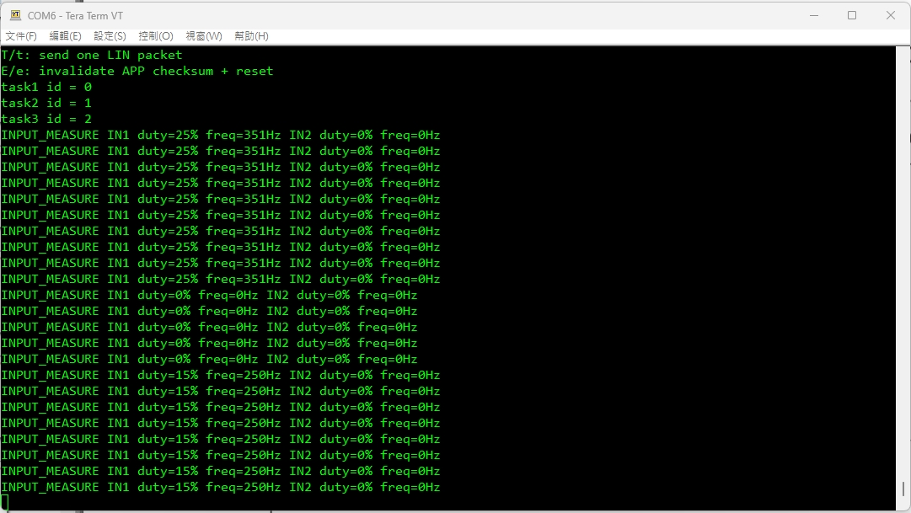

# M2A23BSP_ISP_CAN_PWM_LIN

M2A23 BSP example for:

- `LDROM` CAN ISP bootloader
- `APROM` application with checksum
- `CAN FD`, `PWM`, `ADC`, `GPIO input measure`
- optional `LIN` test flow

Update: `2026/06/27`

## Overview

- MCU / Series:
  `M2A23`
- Board:
  EVB style pinout with external signal and bus test
- Toolchain:
  `Keil uVision5`
- Purpose:
  - verify `LDROM -> APROM` CAN ISP boot flow
  - verify `APROM` checksum handling by `SRecord`
  - verify `CAN FD TX/RX` and CAN wake-up
  - verify `WDT` reset protection in normal run flow
  - verify PWM output, ADC sampling, and external pulse frequency / duty measurement

## Hardware

The product pin assignment follows `HSC ARM CAN Rev1_0 20260601`. The NuMaker-M2A23SG schematic is only a development-board reference; its `PD15` LIN sleep control and VCOM UART routing are not used by the product firmware.

- Bootloader debug UART:
  `UART1`, `PB6=RXD1`, `PB7=TXD1`
- Application debug UART:
  `UART1`, `PB6=RXD1`, `PB7=TXD1`
- CAN:
  `CANFD0`, `PC4=RXD`, `PC5=TXD`
- ADC inputs:
  `PB0=ADC0_CH0`, `PB2=ADC0_CH2`
- PWM outputs:
  `PB1=PWM0_CH4`, `PB3=PWM0_CH2`, `PF5=PWM0_CH0`
- BPWM output:
  `PA3=BPWM0_CH3`, `250Hz`, default `0%`
- External pulse inputs:
  `PB5=INT0`, `PB4=INT1`
- Test equipment:
  serial terminal, CAN analyzer / PCAN, oscilloscope

## Pin Map

| Board signal | MCU pin | Peripheral / mode | Direction | Note |
| --- | --- | --- | --- | --- |
| `DBG_RX` | `PB6` | `UART1_RXD` | Input | LDROM and AP debug UART |
| `DBG_TX` | `PB7` | `UART1_TXD` | Output | LDROM and AP debug UART |
| `LIN_RX` | `PA6` | `UART0_RXD` | Input | ATA663254 RXD |
| `LIN_TX` | `PA7` | `UART0_TXD` | Output | ATA663254 TXD |
| `EN` | `PB14` | GPIO output | Output | High enables ATA663254 normal mode |
| `CANFD_RXD` | `PC4` | `CANFD0_RXD` | Input | CAN / CAN FD bus |
| `CANFD_TXD` | `PC5` | `CANFD0_TXD` | Output | CAN / CAN FD bus |
| `ADC_B0` | `PB0` | `ADC0_CH0` | Input | ADC channel B0 |
| `ADC_B1` | `PB2` | `ADC0_CH2` | Input | ADC channel B1 |
| `PWM_SET1` | `PF5` | `PWM0_CH0` | Output | PWM group 1, `100Hz` |
| `PWM_SET2` | `PB3` | `PWM0_CH2` | Output | PWM group 2, `200Hz` |
| `PWM_SET3` | `PB1` | `PWM0_CH4` | Output | PWM group 3, `400Hz` |
| `IN1_SET` | `PB5` | `INT0` | Input | Input measurement channel 1 |
| `IN2_SET` | `PB4` | `INT1` | Input | Input measurement channel 2 |
| `LED_SET1~3` | `PA0~PA2` | GPIO output | Output | GPIO output mirror |
| `LED_SET4` | `PA3` | GPIO or `BPWM0_CH3` | Output | BPWM is `250Hz`, default `0%`; selected by `DRV_GPIO_LED_SET4_GPIO_ENABLE` |
| `LED_SET5~6` | `PA4~PA5` | GPIO output | Output | GPIO output mirror |
| `SW1~SW4` | `PA15~PA12` | GPIO input | Input | Button inputs |
| `SW5~SW6` | `PC0~PC1` | GPIO input | Input | Button inputs |

When `ENABLE_LIN_SLAVE == 1`:

- AP debug UART remains on `UART1`, `PB6=RXD1`, `PB7=TXD1`
- LIN bus uses `UART0`, `PA6=RXD0`, `PA7=TXD0`

Code location:

- [main.c](SampleCode/Template/AP/main.c)

```c
#define APP_DEBUG_UART                                  UART1
#define APP_DEBUG_UART_RST                              UART1_RST
#define APP_DEBUG_UART_IRQn                             UART1_IRQn
#define APP_DEBUG_UART_IRQHandler                       UART1_IRQHandler
```

.jpg)

## Build Environment

- BSP / SDK:
  Nuvoton `M2A23` BSP
- IDE / compiler:
  `Keil uVision5`
- Project paths:
  - AP: [SampleCode/Template/AP/Keil/Template.uvprojx](SampleCode/Template/AP/Keil/Template.uvprojx)
  - ISP: [SampleCode/Template/ISP_CAN/Keil/Template.uvprojx](SampleCode/Template/ISP_CAN/Keil/Template.uvprojx)
- Output images:
  - LDROM bootloader image
  - APROM application image with CRC32 at the last 4 bytes

## Project Layout

- AP application:
  [SampleCode/Template/AP](SampleCode/Template/AP)
- LDROM CAN ISP bootloader:
  [SampleCode/Template/ISP_CAN](SampleCode/Template/ISP_CAN)
- Memory map:
  [SampleCode/Template/memory_map.h](SampleCode/Template/memory_map.h)
- AP checksum tool:
  [SampleCode/Template/AP/Keil/checksum_config.cmd](SampleCode/Template/AP/Keil/checksum_config.cmd)
  [SampleCode/Template/AP/Keil/generateChecksum.bat](SampleCode/Template/AP/Keil/generateChecksum.bat)

## Flash Layout

Unified flash layout:

- `LDROM` holds CAN ISP bootloader
- `APROM` holds application image
- application checksum is stored at the last 4 bytes of APROM image

| Region | Address | Size | Note |
| --- | --- | --- | --- |
| `LDROM` | `0x00100000 ~ 0x00100FFF` | `4KB` | CAN ISP bootloader |
| `APROM` | `0x00000000 ~ 0x0000FFFF` | `64KB` | application image |
| `APP checksum` | `0x0000FFFC` | `4 bytes` | CRC32 at end of AP image |

Related files:

- [memory_map.h](SampleCode/Template/memory_map.h)
- [checksum_config.cmd](SampleCode/Template/AP/Keil/checksum_config.cmd)

## LDROM CAN ISP

Bootloader project:

- [SampleCode/Template/ISP_CAN/main.c](SampleCode/Template/ISP_CAN/main.c)

Behavior:

- runs in `LDROM`
- uses `Classical CAN`, `500 kbps`
- debug UART is `UART1`
- validates AP image by:
  - stack pointer range
  - reset vector range and Thumb bit
  - CRC32 at `APP_CHECKSUM_ADDR`
- if AP is valid, bootloader quickly jumps to AP
- if AP is invalid, bootloader stays in CAN ISP mode

CAN ISP IDs:

- master request ID: `0x487`
- device response ID: `0x784`

Supported command groups in current bootloader:

- read device ID
- read config word
- write APROM data
- run APROM

Programming note:

- AP image CRC is generated by post-build script
- Nu-Link programming flow can use the settings shown below



## APROM Application

Application project:

- [SampleCode/Template/AP/main.c](SampleCode/Template/AP/main.c)

Typical power-on log includes:

- clock information
- reset source
- CAN mode / baud rate
- PWM startup status
- UART key map
- timer task IDs

Image:


### UART Key Map

- `7`
  enter standby and wait for CAN RX wake-up
- `8`
  send CAN SID `0x99`, `8 bytes`
- `9`
  send CAN XID `0x4444`, `32 bytes`
- `E/e`
  invalidate APP checksum and reset

Note:

- the current target uses `drv_lin_slave.c` with `ENABLE_LIN_SLAVE = 1`
- current default log setting is:
  - `ENABLE_ADC_LOG = 0`
  - `ENABLE_INPUT_MEASURE_LOG = 0`

### GPIO / BPWM Define

Related files:

- [drv_gpio_io.h](SampleCode/Template/AP/drv_gpio_io.h)
- [drv_pwm.h](SampleCode/Template/AP/drv_pwm.h)
- [drv_pwm.c](SampleCode/Template/AP/drv_pwm.c)

Current `PA3` behavior is controlled by:

```c
#define DRV_GPIO_LED_SET4_GPIO_ENABLE                   (0U)
```

PWM / BPWM driver defines:

```c
#define DRV_PWM_GROUP1_CHANNEL                          (0U)
#define DRV_PWM_GROUP2_CHANNEL                          (2U)
#define DRV_PWM_GROUP3_CHANNEL                          (4U)
#define DRV_PWM_GROUP1_FREQ_HZ                          (100UL)
#define DRV_PWM_GROUP2_FREQ_HZ                          (200UL)
#define DRV_PWM_GROUP3_FREQ_HZ                          (400UL)
#define DRV_BPWM_CHANNEL                                (3U)
#define DRV_BPWM_FREQ_HZ                                (250UL)
```

Meaning:

- `1U`
  `PA3` stays as `LED_SET4` GPIO output
- `0U`
  `PA3` GPIO mirror is disabled
  `PA3` is switched to `BPWM0_CH3`

Current GPIO / BPWM related pin defines:

```c
#define LED_SET1                                        (PA0)
#define LED_SET2                                        (PA1)
#define LED_SET3                                        (PA2)
#define LED_SET4                                        (PA3)
#define LED_SET5                                        (PA4)
#define LED_SET6                                        (PA5)
#define SW_1                                            (PA15)
#define SW_2                                            (PA14)
#define SW_3                                            (PA13)
#define SW_4                                            (PA12)
#define SW_5                                            (PC0)
#define SW_6                                            (PC1)
```

### Added BPWM Function

New API:

```c
void DRV_BPWM_SetOutputDutyCycle(uint8_t u8Duty);
```

Behavior:

- output pin:
  `PA3 = BPWM0_CH3`
- output frequency:
  fixed `250Hz`
- default startup duty:
  `0%`
- when duty is `0U`:
  output is forced to logic low
- integration note:
  `PA3` must be released from `LED_SET4` GPIO mode by setting `DRV_GPIO_LED_SET4_GPIO_ENABLE = 0U`

Usage example:

```c
DRV_BPWM_SetOutputDutyCycle(25U);
DRV_BPWM_SetOutputDutyCycle(50U);
DRV_BPWM_SetOutputDutyCycle(0U);
```

## Main Functions

### Watchdog Timer

Behavior:

- `WDT` is enabled in AP application startup
- WDT clock source is `LIRC`
- current setting:
  - timeout: `2^18` WDT clocks = `6.827s`
  - reset delay: `18` WDT clocks = `468.75us`
- `loop()` feeds WDT once per iteration by `WDT_RESET_COUNTER()`
- before entering key `7` standby wait, application closes WDT temporarily
- after CAN wake-up, application re-initializes WDT
- reset source log will show `WDT Reset` if watchdog timeout occurs

Related code:

- [main.c](SampleCode/Template/AP/main.c)

### Timeout / Delay Reference

Current WDT timeout table:

| TOUTSEL | Timeout | Time |
| --- | ---: | ---: |
| `0000` | `2^4` | `0.417 ms` |
| `0001` | `2^6` | `1.667 ms` |
| `0010` | `2^8` | `6.667 ms` |
| `0011` | `2^10` | `26.667 ms` |
| `0100` | `2^12` | `106.667 ms` |
| `0101` | `2^14` | `426.667 ms` |
| `0110` | `2^16` | `1.707 s` |
| `0111` | `2^18` | `6.827 s` |
| `1000` | `2^20` | `27.307 s` |

Current WDT reset delay table:

| Reset delay | Time |
| ---: | ---: |
| `3 clocks` | `78.125 us` |
| `18 clocks` | `468.75 us` |
| `130 clocks` | `3.385 ms` |
| `1026 clocks` | `26.719 ms` |

### CAN FD TX / RX

CAN application driver:

- [drv_can_fd.c](SampleCode/Template/AP/drv_can_fd.c)

Behavior:

- key `8` sends SID `0x99`, `8 bytes`
- key `9` sends XID `0x4444`, `32 bytes`
- received CAN / CAN FD frames are printed on UART
- specific SID `0xBC` is parsed into `g_au8CanRxDataBC[0..7]`

#### Tx queued handling

- the three default dedicated Tx buffers are selected round-robin; a pending buffer is never overwritten
- `CAN_SendMessage()` returns `eDRV_CAN_TX_QUEUED`, `BUSY`, `BUS_OFF`, `INVALID`, or `CONTROLLER_ERROR`
- an application Tx event is cleared only after `eDRV_CAN_TX_QUEUED`; `BUSY` and `BUS_OFF` remain pending for a later loop

`eDRV_CAN_TX_QUEUED` means that the hardware accepted the request. It does not mean that another CAN node has ACKed the frame. The application should advance its transmit state only after receiving this result.

```c
E_DRV_CAN_TX_RESULT eCanTxResult;

eCanTxResult = CAN_SendMessage(TRUE, &g_sTxMsgFrame, eCANFD_SID, 0x99, 8);
eCanTxResult = CAN_SendMessage(TRUE, &g_sTxMsgFrame, eCANFD_XID, 0x4444, 32);
```

#### CAN Bus-Off recovery

- Error Warning, Error Passive, Bus-Off, arbitration/data protocol error, and Message RAM access failure interrupts are enabled
- the ISR only records status; `CAN_Process(get_tick())` logs errors and performs Bus-Off recovery in main-loop context
- recovery enters INIT, cancels pending Tx buffers, clears Restricted Operation Mode/error flags, returns to normal mode, and retries after a bounded timeout

Bus-Off bench test:

1. Make the MCU transmit while no active CAN node provides ACK, then confirm `CAN error` and `CAN Bus-Off recovery start` logs.
2. While Bus-Off is active, trigger another key `8` or `9`; this not-yet-queued event must remain pending.
3. Reconnect an active analyzer/node with matching nominal/data bitrate.
4. Confirm `CAN Bus-Off recovery completed` and that the retained event is queued afterward.

Recovery cancels hardware requests that were already pending when Bus-Off occurred. `QUEUED` is therefore not an end-to-end delivery guarantee; a protocol that requires guaranteed one-shot delivery still needs a Tx-complete/application-ACK policy.

Images:


### CAN Wake-up

Behavior:

- key `7` enters CPU idle / standby wait state
- wake-up source is CAN RX IRQ
- wake-up result is printed after CAN activity

Image:


### PWM Output

PWM driver:

- [drv_pwm.c](SampleCode/Template/AP/drv_pwm.c)

Default outputs:

- `PWM0_CH0` on `PF5`: `100Hz`, `60%`
- `PWM0_CH2` on `PB3`: `200Hz`, `30%`
- `PWM0_CH4` on `PB1`: `400Hz`, `30%`

Startup log prints all three PWM groups.

### ADC Sampling

ADC driver:

- [drv_adc.c](SampleCode/Template/AP/drv_adc.c)

Behavior:

- samples `PB0/ADC0_CH0` and `PB2/ADC0_CH2`
- moving average is updated every `10ms`
- current default log prints:
  - cached `AVDD`
  - raw ADC code
  - converted voltage in `mV`

Image:


### External Pulse Measurement

GPIO input measure driver:

- [drv_gpio_io.c](SampleCode/Template/AP/drv_gpio_io.c)

Behavior:

- `PB5/INT0` measures channel 1 input pulse
- `PB4/INT1` measures channel 2 input pulse
- frequency / duty are measured from edge timestamps using `TIMER2` free-running counter
- input timeout returns channel result to `0Hz / 0%`

Current default:

- measurement remains active
- UART log is disabled by `ENABLE_INPUT_MEASURE_LOG = 0`

Reference image:



### LIN Slave Path

LIN drivers:

- [slave driver](SampleCode/Template/AP/drv_lin_slave.c)
- [master driver](SampleCode/Template/AP/drv_lin_master.c)

The drivers are separate UART0 owners and must not be compiled into the same target. The current AP target includes only `drv_lin_slave.c`; `drv_lin_master.c` remains available for a future master project.

Node roles:

- the vehicle ECU is the LIN master and owns the schedule
- the M2A23 lamp module is a LIN slave
- the ECU sends every header (`break + sync + PID`)
- for an ECU-published frame, the M2A23 is the subscriber and receives the response data
- for an M2A23-published feedback frame, the M2A23 waits for the ECU header and then returns only data and checksum
- the lamp module must not generate a master header on the vehicle network

Current default:

- `ENABLE_LIN_SLAVE = 1`
- the application starts slave receive mode

When enabled:

- LIN baud rate is `19200`
- the current receive example listens for frame ID `0x30` with 8 data bytes
- classic checksum is validated and the received data is printed from the main loop
- LIN uses `UART0`, `PA6=RXD0`, `PA7=TXD0`
- ATA663254 `EN` is driven high through `PB14`

Slave driver APIs:

- `DRV_LIN_SLAVE_StartReceive()` configures the M2A23 as subscriber for one PID
- `DRV_LIN_SLAVE_StartResponse()` prepares data and checksum, waits for the matching ECU header, and then sends only the slave response
- hardware MUTE/PID matching prevents unrelated ECU headers from starting reception or a slave response
- the slave never sends break, sync or PID; those header fields always come from the ECU master
- classic and enhanced checksum modes are supported
- one PID is active in the UART hardware filter at a time; the most recent start call selects receive or response mode

The production LIN matrix/LDF must define the command and feedback PIDs, frame lengths, publishers, checksum models, schedule and timeout requirements. Multiple command and feedback frames require application switching based on that schedule. No master transmit path is linked into the current application.

## Configuration

Main configuration files:

- [main.c](SampleCode/Template/AP/main.c)
- [drv_lin_slave.h](SampleCode/Template/AP/drv_lin_slave.h)
- [memory_map.h](SampleCode/Template/memory_map.h)

Important macros:

```c
#define ENABLE_LIN_SLAVE                (1U)
#define ENABLE_ADC_LOG                  (0U)
#define ENABLE_INPUT_MEASURE_LOG        (0U)
#define APP_CHECKSUM_ADDR               (APP_END_ADDR - 4UL)
/* WDT is enabled in code by WDT_Init() */
```

Debug UART selection:

- LDROM and AP debug use `UART1`, `PB6=RXD1`, `PB7=TXD1`
- `UART0`, `PA6=RXD0`, `PA7=TXD0` are reserved for LIN when `ENABLE_LIN_SLAVE == 1`

## Test Flow

1. Build and program LDROM bootloader and APROM application.
2. Open UART terminal for boot or app log.
3. Connect CAN analyzer to `CANFD0`.
4. Power on or reset MCU.
5. Confirm power-on log, PWM status, and key map.
6. Trigger key `8` / `9` / `7` and confirm expected CAN behavior.
7. If WDT behavior is under test, temporarily stop feeding `WDT_RESET_COUNTER()` and confirm watchdog reset after about `6.827s`.
8. If ADC or pulse input is under test, inject analog / digital signal and compare UART log with scope or meter.

## Validation

- UART log:
  - power-on log
  - ADC log
  - CAN RX / TX log
  - wake-up log
  - WDT reset source log
- External tool:
  - PCAN or CAN analyzer should observe the configured IDs and payloads
- Scope:
  - PWM outputs should match `100Hz`, `200Hz`, `400Hz`
  - ADC input voltage and external pulse input can be cross-checked by oscilloscope

## Related Files

- [AP main](SampleCode/Template/AP/main.c)
- [ISP main](SampleCode/Template/ISP_CAN/main.c)
- [ADC driver](SampleCode/Template/AP/drv_adc.c)
- [PWM driver](SampleCode/Template/AP/drv_pwm.c)
- [GPIO input measure driver](SampleCode/Template/AP/drv_gpio_io.c)
- [CAN driver](SampleCode/Template/AP/drv_can_fd.c)
- [LIN slave driver](SampleCode/Template/AP/drv_lin_slave.c)
- [LIN master driver](SampleCode/Template/AP/drv_lin_master.c)
- [AP project file](SampleCode/Template/AP/Keil/Template.uvprojx)
- [ISP project file](SampleCode/Template/ISP_CAN/Keil/Template.uvprojx)

## Notes

- AP debug UART remains on `UART1`, `PB6/PB7`, when LIN is enabled.
- `AVDD` is currently calculated once during ADC init and reused in later ADC log output.
- Input measure function is active even when its UART log is disabled.
- CAN wake-up is based on CAN RX interrupt, not UART key input after entering standby.
- WDT is intentionally closed before standby wait and re-opened after CAN wake-up.

## Revision

- `2026/05/26`: rewrite README for current `ISP + CAN + PWM + ADC + LIN` project
- `2026/06/01`: add WDT behavior, timeout table, and standby interaction notes
