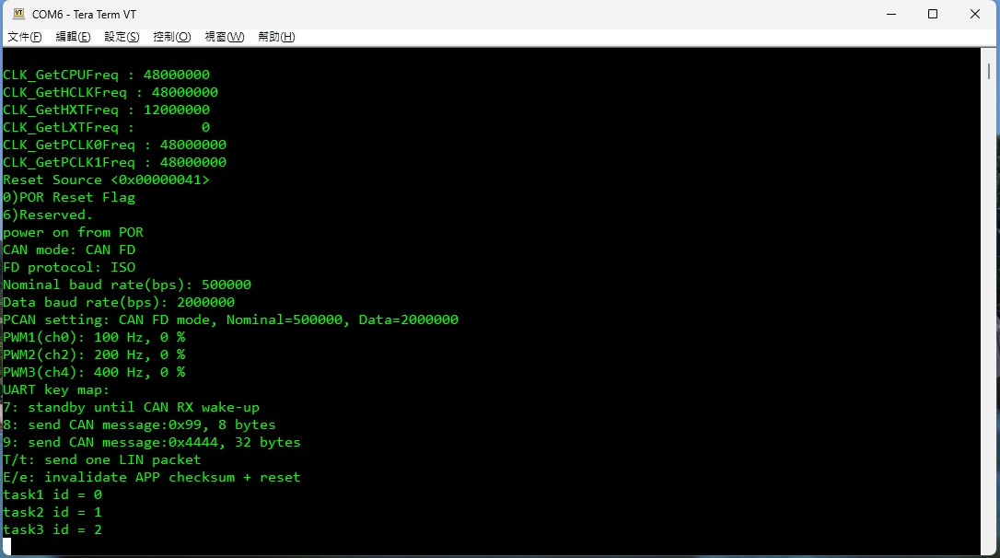
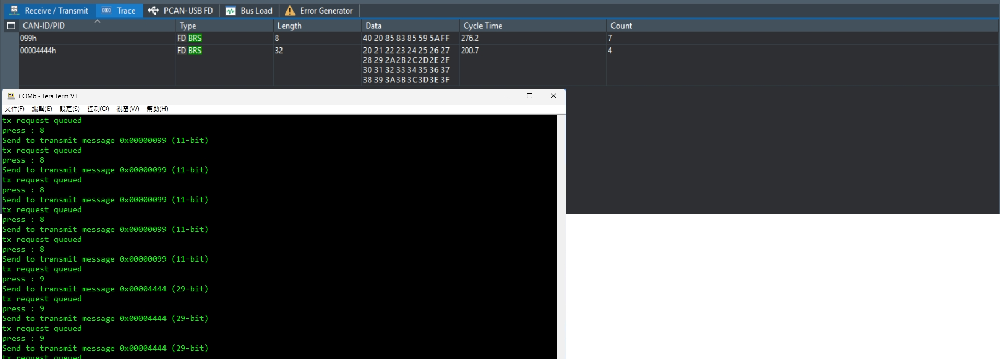
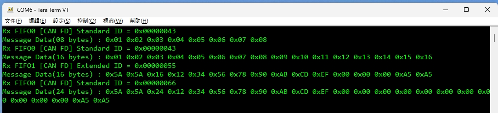
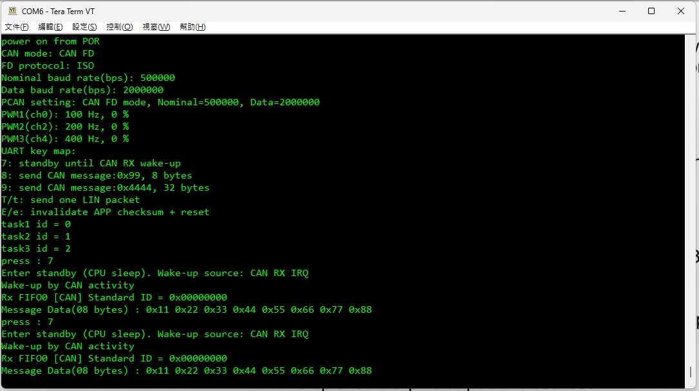
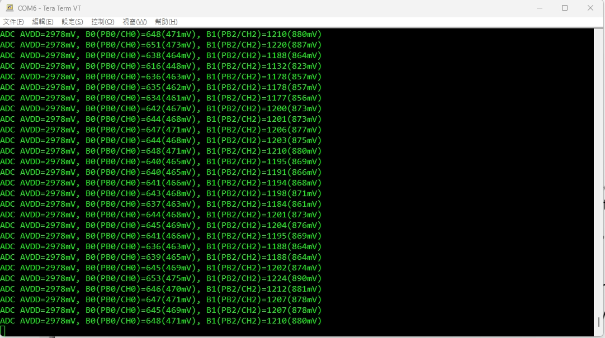

# M2A23BSP_ISP_CAN_PWM_LIN

[繁體中文](README.md) | [English](README.en.md)

M2A23 BSP 範例，涵蓋：

- `LDROM` CAN ISP bootloader。
- 含 checksum 的 `APROM` 應用程式。
- `CAN FD`、`PWM`、`ADC` 與 `GPIO input measure`。
- 可設定的 `LIN Slave` 測試流程。

[接腳配置](#pin-map) | [建置環境](#build-environment) | [CAN ISP 開機流程](#ldrom-can-isp) | [Duty 解析度](#pwm--bpwm-duty-resolution) | [LIN / PLIN](#lin-slave-path)

<a id="overview"></a>

## 專案概覽

- MCU／系列：`M2A23`。
- 板端接腳：依 `HSC ARM CAN Rev1_0 20260601` 產品 PCB 配置。
- 開發工具：`Keil uVision5`。
- 開機流程：透過 CAN ISP 實作 `LDROM -> APROM`。
- 映像完整性：使用 `SRecord` 處理 `APROM` checksum。
- 匯流排功能：`CAN FD TX/RX`、CAN 喚醒，以及 LIN slave 回覆／接收。
- 執行保護：正常執行流程中的 `WDT` 重置保護。
- 周邊範例：PWM 輸出、ADC 取樣，以及外部脈波頻率／duty 量測。

<a id="hardware"></a>

## 硬體配置

產品接腳依據 `HSC ARM CAN Rev1_0 20260601`。NuMaker-M2A23SG 電路圖僅作為開發板參考；產品韌體不使用該開發板的 `PD15` LIN sleep 控制與 VCOM UART 配線。

- Bootloader debug UART：`UART1`，`PB6=RXD1`、`PB7=TXD1`。
- 應用程式 debug UART：`UART1`，`PB6=RXD1`、`PB7=TXD1`。
- CAN：`CANFD0`，`PC4=RXD`、`PC5=TXD`。
- ADC 輸入：`PB0=ADC0_CH0`、`PB2=ADC0_CH2`。
- PWM 輸出：`PB1=PWM0_CH4`、`PB3=PWM0_CH2`、`PF5=PWM0_CH0`。
- BPWM 輸出：`PA3=BPWM0_CH3`，`250Hz`，預設 `0%`。
- 外部脈波輸入：`PB5=INT0`、`PB4=INT1`。
- 測試設備：UART terminal、CAN analyzer／PCAN、示波器。

<a id="pin-map"></a>

## 接腳配置

| 板端訊號 | MCU 接腳 | 周邊／模式 | 方向 | 說明 |
| --- | --- | --- | --- | --- |
| `DBG_RX` | `PB6` | `UART1_RXD` | 輸入 | LDROM 與 AP debug UART |
| `DBG_TX` | `PB7` | `UART1_TXD` | 輸出 | LDROM 與 AP debug UART |
| `LIN_RX` | `PA6` | `UART0_RXD` | 輸入 | ATA663254 RXD |
| `LIN_TX` | `PA7` | `UART0_TXD` | 輸出 | ATA663254 TXD |
| `EN` | `PB14` | GPIO output | 輸出 | High 啟用 ATA663254 normal mode |
| `CANFD_RXD` | `PC4` | `CANFD0_RXD` | 輸入 | CAN／CAN FD 匯流排 |
| `CANFD_TXD` | `PC5` | `CANFD0_TXD` | 輸出 | CAN／CAN FD 匯流排 |
| `ADC_B0` | `PB0` | `ADC0_CH0` | 輸入 | ADC B0 通道 |
| `ADC_B1` | `PB2` | `ADC0_CH2` | 輸入 | ADC B1 通道 |
| `PWM_SET1` | `PF5` | `PWM0_CH0` | 輸出 | PWM group 1，`100Hz` |
| `PWM_SET2` | `PB3` | `PWM0_CH2` | 輸出 | PWM group 2，`200Hz` |
| `PWM_SET3` | `PB1` | `PWM0_CH4` | 輸出 | PWM group 3，`400Hz` |
| `IN1_SET` | `PB5` | `INT0` | 輸入 | 脈波量測通道 1 |
| `IN2_SET` | `PB4` | `INT1` | 輸入 | 脈波量測通道 2 |
| `LED_SET1~3` | `PA0~PA2` | GPIO output | 輸出 | GPIO 輸入對應輸出 |
| `LED_SET4` | `PA3` | GPIO 或 `BPWM0_CH3` | 輸出 | BPWM 為 `250Hz`、預設 `0%`；由 `DRV_GPIO_LED_SET4_GPIO_ENABLE` 選擇 |
| `LED_SET5~6` | `PA4~PA5` | GPIO output | 輸出 | GPIO 輸入對應輸出 |
| `SW1~SW4` | `PA15~PA12` | GPIO input | 輸入 | 按鍵輸入 |
| `SW5~SW6` | `PC0~PC1` | GPIO input | 輸入 | 按鍵輸入 |

當 `ENABLE_LIN_SLAVE == 1`：

- AP debug UART 維持 `UART1`，`PB6=RXD1`、`PB7=TXD1`。
- LIN 使用 `UART0`，`PA6=RXD0`、`PA7=TXD0`。

程式位置：[main.c](SampleCode/Template/AP/main.c)。

```c
#define APP_DEBUG_UART                                  UART1
#define APP_DEBUG_UART_RST                              UART1_RST
#define APP_DEBUG_UART_IRQn                             UART1_IRQn
#define APP_DEBUG_UART_IRQHandler                       UART1_IRQHandler
```

.jpg)

<a id="build-environment"></a>

## 建置環境

- BSP／SDK：Nuvoton `M2A23` BSP。
- IDE／編譯器：`Keil uVision5`。
- AP 專案：[SampleCode/Template/AP/Keil/Template.uvprojx](SampleCode/Template/AP/Keil/Template.uvprojx)。
- ISP 專案：[SampleCode/Template/ISP_CAN/Keil/Template.uvprojx](SampleCode/Template/ISP_CAN/Keil/Template.uvprojx)。
- LDROM 產物：CAN ISP bootloader 映像。
- APROM 產物：最後 4 bytes 含 CRC32 的應用程式映像。

<a id="project-layout"></a>

## 專案結構

- AP 應用程式：[SampleCode/Template/AP](SampleCode/Template/AP)。
- LDROM CAN ISP bootloader：[SampleCode/Template/ISP_CAN](SampleCode/Template/ISP_CAN)。
- 記憶體配置：[SampleCode/Template/memory_map.h](SampleCode/Template/memory_map.h)。
- AP checksum 設定：[checksum_config.cmd](SampleCode/Template/AP/Keil/checksum_config.cmd)。
- AP checksum 腳本：[generateChecksum.bat](SampleCode/Template/AP/Keil/generateChecksum.bat)。

<a id="flash-layout"></a>

## Flash 配置

- `LDROM` 放置 CAN ISP bootloader。
- `APROM` 放置應用程式映像。
- 應用程式 checksum 存放於 APROM 映像最後 4 bytes。

| 區域 | 位址 | 大小 | 說明 |
| --- | --- | --- | --- |
| `LDROM` | `0x00100000 ~ 0x00100FFF` | `4KB` | CAN ISP bootloader |
| `APROM` | `0x00000000 ~ 0x0000FFFF` | `64KB` | 應用程式映像 |
| `APP checksum` | `0x0000FFFC` | `4 bytes` | AP 映像末端 CRC32 |

相關檔案：

- [memory_map.h](SampleCode/Template/memory_map.h)
- [checksum_config.cmd](SampleCode/Template/AP/Keil/checksum_config.cmd)

<a id="ldrom-can-isp"></a>

## LDROM CAN ISP

Bootloader 程式：[SampleCode/Template/ISP_CAN/main.c](SampleCode/Template/ISP_CAN/main.c)。

執行行為：

- 執行於 `LDROM`。
- 使用 `Classical CAN`，`500 kbps`。
- Debug UART 為 `UART1`。
- 檢查 AP stack pointer 範圍。
- 檢查 reset vector 範圍與 Thumb bit。
- 檢查 `APP_CHECKSUM_ADDR` 的 CRC32。
- AP 有效時，bootloader 隨即跳至 AP。
- AP 無效時，停留在 CAN ISP 模式。

CAN ISP ID：

- Master request ID：`0x487`。
- Device response ID：`0x784`。

目前 bootloader 支援的命令群組：

- 讀取 device ID。
- 讀取 config word。
- 寫入 APROM 資料。
- 執行 APROM。

燒錄說明：

- AP 映像 CRC 由 post-build 腳本產生。
- Nu-Link 燒錄流程可參照下圖設定。


<a id="aprom-application"></a>

## APROM 應用程式

應用程式：[SampleCode/Template/AP/main.c](SampleCode/Template/AP/main.c)。

開機 log 包含：

- 時脈資訊。
- Reset source。
- CAN 模式／鮑率。
- PWM 啟動狀態。
- UART 按鍵功能。
- Timer task ID。



<a id="uart-key-map"></a>

### UART 按鍵功能

- `7`：進入待機，等待 CAN RX 喚醒。
- `8`：發送 CAN SID `0x99`，`8 bytes`。
- `9`：發送 CAN XID `0x4444`，`32 bytes`。
- `E/e`：使 APP checksum 無效，然後重置。
- `X/x`、`Z/z`：呼叫 `SYS_ResetChip()` 重置 MCU，不使 APP checksum 無效。

預設設定：

- 目前 target 使用 `drv_lin_slave.c`，`ENABLE_LIN_SLAVE = 1`。
- ADC log 預設關閉：`ENABLE_ADC_LOG = 0`。
- 輸入量測 log 預設關閉：`ENABLE_INPUT_MEASURE_LOG = 0`。

<a id="gpio--bpwm-define"></a>

### GPIO／BPWM 定義

相關檔案：

- [drv_gpio_io.h](SampleCode/Template/AP/drv_gpio_io.h)
- [drv_pwm.h](SampleCode/Template/AP/drv_pwm.h)
- [drv_pwm.c](SampleCode/Template/AP/drv_pwm.c)

`PA3` 行為由以下 define 控制：

```c
#define DRV_GPIO_LED_SET4_GPIO_ENABLE                   (0U)
```

PWM／BPWM driver 定義：

```c
#define DRV_PWM_DUTY_RESOLUTION                         (10000U)
#define DRV_PWM_DUTY_MAX                                (DRV_PWM_DUTY_RESOLUTION)
#define DRV_PWM_GROUP1_CHANNEL                          (0U)
#define DRV_PWM_GROUP2_CHANNEL                          (2U)
#define DRV_PWM_GROUP3_CHANNEL                          (4U)
#define DRV_PWM_GROUP1_FREQ_HZ                          (100UL)
#define DRV_PWM_GROUP2_FREQ_HZ                          (200UL)
#define DRV_PWM_GROUP3_FREQ_HZ                          (400UL)
#define DRV_BPWM_CHANNEL                                (3U)
#define DRV_BPWM_FREQ_HZ                                (250UL)
```

- `1U`：`PA3` 維持 `LED_SET4` GPIO output。
- `0U`：停用 `PA3` GPIO 輸入對應輸出，改為 `BPWM0_CH3`。

GPIO／BPWM 接腳定義：

```c
#define LED_SET1                                        (PA0)
#define LED_SET2                                        (PA1)
#define LED_SET3                                        (PA2)
#define LED_SET4                                        (PA3)
#define LED_SET5                                        (PA4)
#define LED_SET6                                        (PA5)
#define SW_1                                            (PA15)
#define SW_2                                            (PA14)
#define SW_3                                            (PA13)
#define SW_4                                            (PA12)
#define SW_5                                            (PC0)
#define SW_6                                            (PC1)
```

<a id="added-bpwm-function"></a>
<a id="bpwm-function"></a>

### BPWM 功能

API：

```c
void DRV_BPWM_SetOutputDutyCycle(uint16_t u16Duty);
```

- 輸出接腳：`PA3 = BPWM0_CH3`。
- 固定頻率：`250Hz`。
- 啟動 duty：`0%`。
- Duty 為 `0U` 時，輸出強制為 logic low。
- `DRV_GPIO_LED_SET4_GPIO_ENABLE = 0U` 時，`PA3` 釋出 GPIO 控制並切換為 BPWM。

使用範例：

```c
/* DRV_PWM_DUTY_RESOLUTION = 10000U */
DRV_BPWM_SetOutputDutyCycle(2500U); /* 25.00% */
DRV_BPWM_SetOutputDutyCycle(5000U); /* 50.00% */
DRV_BPWM_SetOutputDutyCycle(0U);
```

<a id="pwm--bpwm-duty-resolution"></a>

### PWM／BPWM Duty 解析度

兩支輸出 API 均使用 `uint16_t`，數值單位由 `DRV_PWM_DUTY_RESOLUTION` 決定。預設為 `10000U`，每單位代表 `0.01%`。

```c
void DRV_PWM_SetOutputDutyCycle(E_DRV_PWM_GROUP eGroup, uint16_t u16Duty);
void DRV_BPWM_SetOutputDutyCycle(uint16_t u16Duty);
```

| `DRV_PWM_DUTY_RESOLUTION` | 每單位 | 範例 1 | 範例 2 | 100% 輸入值 |
| --- | --- | --- | --- | --- |
| `10000U` | `0.01%` | `8230U` = `82.30%` | `4750U` = `47.50%` | `10000U` |
| `1000U` | `0.1%` | `823U` = `82.3%` | `475U` = `47.5%` | `1000U` |
| `100U` | `1%` | `82U` = `82%` | `47U` = `47%` | `100U` |

依選定的解析度使用對應範例：

```c
/* #define DRV_PWM_DUTY_RESOLUTION (10000U) */
DRV_PWM_SetOutputDutyCycle(eDRV_PWM_GROUP_1, 8230U); /* 82.30% */
DRV_BPWM_SetOutputDutyCycle(4750U);                 /* 47.50% */
DRV_PWM_SetOutputDutyCycle(eDRV_PWM_GROUP_2, 8233U); /* 82.33% */

/* #define DRV_PWM_DUTY_RESOLUTION (1000U) */
DRV_PWM_SetOutputDutyCycle(eDRV_PWM_GROUP_1, 823U);  /* 82.3% */
DRV_BPWM_SetOutputDutyCycle(475U);                  /* 47.5% */

/* #define DRV_PWM_DUTY_RESOLUTION (100U) */
DRV_PWM_SetOutputDutyCycle(eDRV_PWM_GROUP_1, 82U);   /* 82% */
DRV_BPWM_SetOutputDutyCycle(47U);                   /* 47% */
```

- `DRV_PWM_DUTY_MAX` 隨解析度變更；超出上限的輸入會限制為 100%。其他解析度值會在編譯時被拒絕。
- 三種解析度下，啟動 duty 均為 PWM1 `60%`、PWM2 `30%`、PWM3 `30%`、BPWM `0%`。輸出頻率與接腳不變。
- `0U` 使用 output masking 強制輸出 logic low，不只依賴 comparator 設為零。
- 狀態 log 在 `10000U` 顯示兩位小數、`1000U` 顯示一位小數、`100U` 不顯示小數；顯示值為要求值，不是實測值。
- API 呼叫需使用對應單位：預設 `10000U` 時，`60U` 代表 `0.60%`；`60.00%` 應使用 `6000U`，不使用浮點數輸入。
- Comparator 使用 32-bit 整數運算，四捨五入到最近 timer tick。實際波形解析度取決於每週期 `CNR + 1` 個 ticks；至少需要 10,000 ticks，tick 步距才不會粗於 `0.01%`。

<a id="main-functions"></a>

## 主要功能

<a id="watchdog-timer"></a>

### 看門狗計時器

- AP 啟動時啟用 `WDT`。
- WDT 時脈來源為 `LIRC`。
- Timeout：`2^18` 個 WDT clocks，約 `6.827s`。
- Reset delay：`18` 個 WDT clocks，約 `468.75us`。
- `loop()` 每次迴圈呼叫 `WDT_RESET_COUNTER()` 餵狗。
- 按鍵 `7` 進入待機等待前，暫時關閉 WDT。
- CAN 喚醒後重新初始化 WDT。
- 若由 watchdog timeout 重置，reset source log 顯示 `WDT Reset`。

程式位置：[main.c](SampleCode/Template/AP/main.c)。

<a id="timeout--delay-reference"></a>

### Timeout／Delay 參考

WDT timeout 對照：

| TOUTSEL | Timeout | 時間 |
| --- | ---: | ---: |
| `0000` | `2^4` | `0.417 ms` |
| `0001` | `2^6` | `1.667 ms` |
| `0010` | `2^8` | `6.667 ms` |
| `0011` | `2^10` | `26.667 ms` |
| `0100` | `2^12` | `106.667 ms` |
| `0101` | `2^14` | `426.667 ms` |
| `0110` | `2^16` | `1.707 s` |
| `0111` | `2^18` | `6.827 s` |
| `1000` | `2^20` | `27.307 s` |

WDT reset delay 對照：

| Reset delay | 時間 |
| ---: | ---: |
| `3 clocks` | `78.125 us` |
| `18 clocks` | `468.75 us` |
| `130 clocks` | `3.385 ms` |
| `1026 clocks` | `26.719 ms` |

<a id="can-fd-tx--rx"></a>

### CAN FD 發送／接收

CAN driver：[drv_can_fd.c](SampleCode/Template/AP/drv_can_fd.c)。

- 按鍵 `8` 發送 SID `0x99`，`8 bytes`。
- 按鍵 `9` 發送 XID `0x4444`，`32 bytes`。
- 收到的 CAN／CAN FD frame 由 UART 印出。
- SID `0xBC` 的資料另外解析至 `g_au8CanRxDataBC[0..7]`。

<a id="tx-queued-handling"></a>

#### TX 排入硬體緩衝區

- 預設三個 dedicated Tx buffers 採 round-robin 選擇，不覆寫 pending buffer。
- `CAN_SendMessage()` 回傳 `eDRV_CAN_TX_QUEUED`、`BUSY`、`BUS_OFF`、`INVALID` 或 `CONTROLLER_ERROR`。
- 應用程式只在 `eDRV_CAN_TX_QUEUED` 後清除 TX event；`BUSY` 與 `BUS_OFF` 保留至後續 loop 重試。

`eDRV_CAN_TX_QUEUED` 代表硬體接受了發送要求，不代表其他 CAN 節點已 ACK。應用程式應在取得此結果後，才推進發送狀態。

```c
E_DRV_CAN_TX_RESULT eCanTxResult;

eCanTxResult = CAN_SendMessage(TRUE, &g_sTxMsgFrame, eCANFD_SID, 0x99, 8);
eCanTxResult = CAN_SendMessage(TRUE, &g_sTxMsgFrame, eCANFD_XID, 0x4444, 32);
```

<a id="can-bus-off-recovery"></a>

#### CAN Bus-Off 恢復

- 啟用 Error Warning、Error Passive、Bus-Off、arbitration／data protocol error，以及 Message RAM access failure 中斷。
- ISR 只記錄狀態；`CAN_Process(get_tick())` 在主迴圈列印錯誤並處理 Bus-Off 恢復。
- 恢復流程進入 INIT、取消 pending Tx buffers、清除 Restricted Operation Mode／錯誤旗標，再回到 normal mode，並以有界 timeout 重試。

Bus-Off 測試流程：

1. 在沒有 active CAN 節點提供 ACK 的情況下觸發發送，觀察 `CAN error` 與 `CAN Bus-Off recovery start` log。
2. Bus-Off 期間再觸發按鍵 `8` 或 `9`，尚未排入硬體的 event 應保持 pending。
3. 接回 nominal／data bitrate 相符的 active analyzer／節點。
4. 確認 `CAN Bus-Off recovery completed`，以及先前保留的 event 隨後排入硬體。

恢復會取消 Bus-Off 發生時已 pending 的硬體要求。`QUEUED` 不是端到端送達保證；需要一次性可靠送達的協定，仍需 Tx-complete／application-ACK 機制。





<a id="can-wake-up"></a>

### CAN 喚醒

- 按鍵 `7` 進入 CPU idle／standby 等待狀態。
- 喚醒來源為 CAN RX IRQ。
- CAN 活動觸發喚醒後，印出結果。



<a id="pwm-output"></a>

### PWM 輸出

PWM driver：[drv_pwm.c](SampleCode/Template/AP/drv_pwm.c)。

- `PF5` 上的 `PWM0_CH0`：`100Hz`、`60%`。
- `PB3` 上的 `PWM0_CH2`：`200Hz`、`30%`。
- `PB1` 上的 `PWM0_CH4`：`400Hz`、`30%`。
- 啟動 log 列出三組 PWM 狀態。

<a id="adc-sampling"></a>

### ADC 取樣

ADC driver：[drv_adc.c](SampleCode/Template/AP/drv_adc.c)。

- 取樣 `PB0/ADC0_CH0` 與 `PB2/ADC0_CH2`。
- 每 `10ms` 更新移動平均。
- 關閉 ADC log 不影響取樣。
- `ENABLE_ADC_LOG = 1` 時，`APP_ProcessADCEvents()` 每 `1000ms` 印出快取的 `AVDD`、原始 ADC code 與換算後的 `mV` 電壓。



<a id="external-pulse-measurement"></a>

### 外部脈波量測

GPIO input measure driver：[drv_gpio_io.c](SampleCode/Template/AP/drv_gpio_io.c)。

- `PB5/INT0` 量測通道 1 輸入脈波。
- `PB4/INT1` 量測通道 2 輸入脈波。
- 使用 `TIMER2` free-running counter 的邊緣時間戳計算頻率／duty。
- 輸入 timeout 時，通道結果回到 `0Hz / 0%`。
- 預設持續量測；UART log 由 `ENABLE_INPUT_MEASURE_LOG = 0` 關閉。


<a id="lin-slave-path"></a>

### LIN Slave 通訊

LIN drivers：

- [slave driver](SampleCode/Template/AP/drv_lin_slave.c)
- [master driver](SampleCode/Template/AP/drv_lin_master.c)

兩個 driver 分別擁有 UART0，不能同時編入同一個 target。目前 AP 只包含 `drv_lin_slave.c`；`drv_lin_master.c` 保留供獨立的 master 專案使用。

車載節點角色：

- 車體 ECU 為 LIN master，負責排程。
- M2A23 車燈模組為 LIN slave。
- 所有 header（`break + sync + PID`）皆由 ECU 發出。
- ECU 為 publisher 時，M2A23 作為 subscriber 接收 response data。
- M2A23 為 publisher 時，等待 ECU header 後，只回覆 data 與 checksum。
- 車燈模組不在車載匯流排上自行產生 master header。

PLIN 測試角色：

- **PLIN adapter＝LIN Master**，代替車體 ECU。
- **M2A23＝LIN Slave**，每組測試都不變，包含 MCU 發送資料的情況。
- Master／Slave 決定誰發起 header；Publisher／Subscriber 決定誰發送／接收該 frame 的 response（`Data + Checksum`）。**Publisher 不等於 Master，Subscriber 也不等於 Slave。**
- PLIN-View Pro 的 **Direction 代表 PLIN adapter 的 response-data 角色**，不是 M2A23 的角色。PLIN 在 Master 模式下，Subscriber 仍會發出 header，再等 M2A23 資料；Publisher 則發出 header 與 response。
- PLIN 的 **Transmit** 清單包含 master 發起的交易，也包含 Subscriber header；不表示清單內每一筆資料都由 PLIN 發送。
- 本範例的 `MCU TX`／`MCU RX` 與 `LIN TX`／`LIN RX` log，均以 M2A23 的 response-data 方向為準，不是 header 方向。

Header 與 response 的角色定義參考 [PEAK PLIN-API，第 3.5、3.5.1、3.5.2 節](https://www.peak-system.com/produktcd/Develop/PC%20interfaces/Windows/PLIN-API/PLINAPI_enu.pdf)。

預設設定：

- `ENABLE_LIN_SLAVE = 1`。
- 應用程式逐一註冊 PID，不需維護固定 frame table 或實際 frame 數量。
- 8 組獨立註冊範例，涵蓋 1、2、4、8-byte 封包。
- `LIN_SLAVE_DYNAMIC_TX_EXAMPLE = 1U` 示範每秒更新 D8／E2 payload。

啟用後的行為：

- LIN 鮑率為 `19200`。
- 預設 Enhanced checksum；每個 frame 仍可獨立選擇 Classic。
- UART0 硬體偵測 Break，ISR 再檢查 Sync（`0x55`）、驗證並分派 PID。
- RX 資料與 checksum 狀態由主迴圈印出。
- LIN 使用 `UART0`，`PA6=RXD0`、`PA7=TXD0`。
- `PB14` 拉高 ATA663254 的 `EN`。

8 組 frame 設定與固定 TX 回覆資料集中於 [PLIN-View Pro 測試設定](#plin-view-pro-validation)，表格同時標明 PLIN Direction（Master）與 M2A23 動作（Slave）。

- MCU TX：response data 方向為 `M2A23 -> PLIN`。
- MCU RX：response data 方向為 `PLIN -> M2A23`。
- 所有 header 均為 `PLIN -> M2A23`，包含 MCU TX 測試。
- Data length 不包含 checksum byte。

ID `0x10` 的有效 PID 為 `0x50`，不是 `0xD0`。Driver 拒絕 parity 錯誤的 PID，並由主迴圈回報。接受字面值 `0xD0` 屬於非標準相容模式，本範例未啟用。

Slave driver API 與行為：

- `DRV_LIN_SLAVE_RegisterFrame()`：註冊單一 protected PID、方向、資料長度與 checksum 模式。
- `DRV_LIN_SLAVE_UnregisterFrame()`：移除單一 PID，不需重建應用程式表格。
- `DRV_LIN_SLAVE_Start()`：完成註冊與初始 payload 後，啟動接收。
- `DRV_LIN_SLAVE_SetResponseData()`：複製 publisher payload，供下一個對應 header 回覆。
- `DRV_LIN_SLAVE_GetAndClearRxPacketByPid()`：取得指定 RX PID 的待處理封包。
- `DRV_LIN_SLAVE_GetAndClearTxPacket()`：取得 UART 已完成回覆的快照，供主迴圈列印。
- 容量由 `DRV_LIN_SLAVE_MAX_FRAME_COUNT` 設定，預設 `16U`，可設定為 `1U`～`64U`。
- Driver 自行維護實際註冊數量，並拒絕重複 PID 或容量已滿的註冊。
- Header／response 進行中，註冊與移除回傳 `DRV_LIN_SLAVE_BUSY`，不變更 registry，可稍後重試。
- 每個 frame 可獨立選擇 Classic 或 Enhanced checksum。
- 預設巨集 `DRV_LIN_SLAVE_DEFAULT_CHECKSUM_MODE` 為 Enhanced。
- 軟體在查找 PID 前先驗證 parity。
- 停用完整 header decoder 與 MUTE PID filter，讓軟體從 RX FIFO 取得 Sync、PID。
- 回覆資料只填入當下可用的 FIFO 空間；TX-empty 中斷補上剩餘 byte，TX-end 完成 frame。
- Slave 不發送 break、sync 或 PID；這些 header 欄位均由 ECU master 提供。
- TX response buffer 與 RX frame buffer 互相獨立。
- 新註冊的 publisher 在第一次成功更新 payload 前保持靜默。
- 前景更新使用一致的 payload 快照，不改變正在傳送的 response。
- 相容 API `StartFrames()`、`StartReceive()`、`StartResponse()` 會取代整個 registry，目前應用程式不使用這些 API。

<a id="register-individual-pids"></a>

#### 逐一註冊 PID

依序呼叫 `DRV_LIN_SLAVE_Init(19200U)`、註冊所需 PID、準備 TX payload，最後呼叫一次 `DRV_LIN_SLAVE_Start()`。註冊使用含 parity 的 wire PID，不是 PLIN 的 6-bit ID。

```c
DRV_LIN_SLAVE_RegisterFrame(0x2EU, eDRV_LIN_SLAVE_DIRECTION_RESPONSE,
                           1U, eDRV_LIN_SLAVE_CHECKSUM_ENHANCED);
DRV_LIN_SLAVE_RegisterFrame(0xC1U, eDRV_LIN_SLAVE_DIRECTION_RECEIVE,
                           8U, eDRV_LIN_SLAVE_CHECKSUM_ENHANCED);
DRV_LIN_SLAVE_RegisterFrame(0xD8U, eDRV_LIN_SLAVE_DIRECTION_RESPONSE,
                           8U, eDRV_LIN_SLAVE_CHECKSUM_ENHANCED);
DRV_LIN_SLAVE_RegisterFrame(0x50U, eDRV_LIN_SLAVE_DIRECTION_RECEIVE,
                           8U, eDRV_LIN_SLAVE_CHECKSUM_ENHANCED);
DRV_LIN_SLAVE_RegisterFrame(0xE2U, eDRV_LIN_SLAVE_DIRECTION_RESPONSE,
                           2U, eDRV_LIN_SLAVE_CHECKSUM_ENHANCED);
DRV_LIN_SLAVE_RegisterFrame(0xA3U, eDRV_LIN_SLAVE_DIRECTION_RESPONSE,
                           4U, eDRV_LIN_SLAVE_CHECKSUM_ENHANCED);
DRV_LIN_SLAVE_RegisterFrame(0x42U, eDRV_LIN_SLAVE_DIRECTION_RECEIVE,
                           2U, eDRV_LIN_SLAVE_CHECKSUM_ENHANCED);
DRV_LIN_SLAVE_RegisterFrame(0x03U, eDRV_LIN_SLAVE_DIRECTION_RECEIVE,
                           4U, eDRV_LIN_SLAVE_CHECKSUM_ENHANCED);
```

`main.c` 的 `APP_InitLinFrames()` 示範回傳值檢查與啟動順序。

- 新增 RX PID：增加註冊、對應的 master 定義，以及含相同長度應用 buffer 的前景接收分支。
- 新增 TX PID：增加註冊、對應的 master 定義、payload 組包流程與 `SetResponseData()` 呼叫。
- 移除註冊後即停止處理該 PID；範例 updater 會略過已移除 publisher 的 `DRV_LIN_SLAVE_NOT_FOUND`。

執行期間可從前景程式移除 PID：

```c
DRV_LIN_SLAVE_UnregisterFrame(0xD8U);
```

未註冊的 PID 會被忽略。變更既有 frame 的方向、長度或 checksum 模式時，需在 idle 狀態移除並重新註冊，再準備 TX payload。長度範圍為 `1..8` data bytes，不包含 checksum；master 必須使用相同長度與 checksum 類型。

- 將 PLIN ID `0x02` 改為 ID `0x04` 時，wire PID 從 `0x42` 改為 `0xC4`；需一致更新 `LIN_SLAVE_PID_RECEIVE_42` 名稱／數值、註冊／接收引用，以及 PLIN 的 ID。
- 將該 RX 範例從 2 改為 3 bytes 時，需同步修改註冊長度、應用 buffer 長度與 PLIN 長度。
- 註冊資訊與 payload 分離；只改某個 byte 的數值，不需移除註冊或重啟 LIN。

<a id="update-payload-during-operation"></a>

#### 執行期間更新 Payload

在 loop 或前景 timer callback 組好資料後，更新完整 payload。應用程式不附加 checksum byte。

```c
uint8_t au8ResponseD8[8];

au8ResponseD8[0] = 0x01U;
au8ResponseD8[1] = 0x02U;
au8ResponseD8[2] = 0x03U;
au8ResponseD8[3] = 0x04U;
au8ResponseD8[4] = 0x05U;
au8ResponseD8[5] = 0x06U;
au8ResponseD8[6] = 0x07U;
au8ResponseD8[7] = 0x08U;

DRV_LIN_SLAVE_SetResponseData(0xD8U, au8ResponseD8, 8U);
```

- Driver 會複製資料，呼叫返回後可重用區域 buffer。
- 只改區域 buffer 不會更新 driver，需再次呼叫 API。
- Payload 長度必須符合註冊；不符合時保留原 payload。
- 更新不會立即送出 frame；仍由 ECU／PLIN master 發起 header，driver 依當筆 response 快照計算 checksum。
- `APP_UpdateLinResponse()` 為應用程式組包範例；`Task_1000ms_Callback()` 透過前景 `TimerService_Dispatch()` 執行，遞增 D8／E2 共用範例序號後更新。UART ISR 不執行應用程式 callback。
- `LIN_SLAVE_DYNAMIC_TX_EXAMPLE = 1U` 時，D8 byte 0 每秒由 `10`、`11`、`12` 依序遞增，以 8-bit 值循環；其餘保持 `20 30 40 50 60 70 80`，`2E` 持續回覆 `00`。
- E2 byte 0 從 `00` 開始每秒遞增，byte 1 固定 `A5`；A3 固定 `DE AD BE EF`。四組 TX payload 獨立組包，不回送或依賴 RX 資料。
- 設定 `LIN_SLAVE_DYNAMIC_TX_EXAMPLE = 0U` 可保留 D8／E2 初始固定資料。自訂組包流程可在應用事件或指定週期呼叫 `SetResponseData()`。

<a id="process-rx-by-pid"></a>

#### 依 PID 處理 RX

每個註冊的 RX PID 都有獨立 driver mailbox。前景 loop 的 `APP_ProcessLinRx()` 分別讀取四個 RX PID，再將有效資料複製到獨立應用 buffer。各 PID 分支即為資料解析位置；UART ISR 不進行應用解析或列印 log。

| Wire PID | 應用 buffer | Data length |
| --- | --- | ---: |
| `0xC1` | `g_au8LinRxC1[8]` | 8 |
| `0x50` | `g_au8LinRx50[8]` | 8 |
| `0x42` | `g_au8LinRx42[2]` | 2 |
| `0x03` | `g_au8LinRx03[4]` | 4 |

兩個 byte 的 PID `0x42` 範例：

```c
S_DRV_LIN_SLAVE_PACKET sLinPacket;

if (DRV_LIN_SLAVE_GetAndClearRxPacketByPid(0x42U, &sLinPacket) != 0U)
{
    if ((sLinPacket.u8ChecksumValid != 0U) &&
        (sLinPacket.u8DataLen == sizeof(g_au8LinRx42)))
    {
        memcpy(g_au8LinRx42, sLinPacket.au8Data, sizeof(g_au8LinRx42));
        /* Process these two bytes here; other RX buffers are unchanged. */
    }
}
```

- Getter 回傳 `1U` 表示取出一筆封包，包含 checksum 錯誤封包；`0U` 表示無待處理資料、未註冊、指定為 TX PID 或輸出指標為 null。
- 範例會印出 checksum 錯誤，但不以錯誤資料覆寫應用 buffer 的最後有效值。第一次有效接收前，buffer 為零；只在成功接收分支處理資料。
- C1 有待處理封包，不影響 50、42、03 接收；取走一個 PID 不會清除其他 PID。
- 每個 mailbox 只保留**一筆**，不是 queue。同 PID 尚未取走又收到完整封包時，丟棄新封包並回報 `DRV_LIN_SLAVE_ERROR_RX_OVERFLOW`。服務頻率需配合 master 排程與前景列印負載。
- 取出的資料會複製到呼叫端儲存空間。移除註冊會丟棄該 PID 尚未取走的封包；初始化會清除所有 mailbox。
- 相容 getter `GetAndClearRxPacket()` 按註冊順序取第一個 ready mailbox，不是匯流排時間順序。兩個 getter 消耗相同 mailbox，不會產生兩份事件。

正式產品的 LIN matrix／LDF 需定義命令與回饋 PID、長度、publisher、checksum、排程及 timeout。目前應用程式不連結 master 發送路徑。

<a id="tx-completion-log"></a>

#### TX 完成 Log

- UART ISR 只在 `TXEND` 後記錄事件，不在更新 payload 或剛填入 FIFO 時記錄。被 Break／錯誤中止的回覆不產生完成事件。
- `APP_ProcessLinTx()` 在主迴圈印出 PID、ID、長度、實際發送資料快照與 checksum，ISR 不列印。
- `DONE` 表示本地 UART 傳送完成，不代表 master 已收到或接受；匯流排接收結果需由 PLIN 核對。
- 事件 FIFO 容量為 `DRV_LIN_SLAVE_TX_EVENT_COUNT`，目前 8 筆。滿載時只丟棄新的 log event，不中斷 LIN TX，並回報 `LIN TX log overflow`。每次 loop 最多處理 8 筆 TX log。
- 初始化與相容 bulk restart 會清除尚未讀取的 TX event。

Log 範例：

```text
LIN TX PID=0x2E ID=0x2E LEN=1 DATA=00 CHK=D1 DONE
LIN TX PID=0xE2 ID=0x22 LEN=2 DATA=00 A5 CHK=77 DONE
```

<a id="plin-view-pro-validation"></a>

#### PLIN-View Pro 測試設定

共通設定：

- Mode：`Master`。
- M2A23 角色：`Slave`，8 組測試均不變。
- Baud rate：`19200 bit/s`。
- 8 組 Trigger 均設為 `Manual`。
- ID 填入 PLIN 的 6-bit ID；Protected ID 自動產生，不以 PID 取代 ID。Length 只計 data，不含 checksum。

**Direction 設定以 PLIN（Master）為準，不直接複製 M2A23（Slave）的角色。** M2A23 動作欄為對照說明，不是 PLIN 欄位。

| ID | Protected ID（自動） | Length | PLIN Direction（Master） | M2A23 動作（Slave） | CST | PLIN Data 填入值 |
| --- | --- | ---: | --- | --- | --- | --- |
| `2Eh` | `2Eh` | 1 | Subscriber | TX / Publisher | Enhanced | 留空 |
| `01h` | `C1h` | 8 | Publisher | RX / Subscriber | Enhanced | `01 02 03 04 05 06 07 08` |
| `18h` | `D8h` | 8 | Subscriber | TX / Publisher | Enhanced | 留空 |
| `10h` | `50h` | 8 | Publisher | RX / Subscriber | Enhanced | `11 22 33 44 55 66 77 88` |
| `22h` | `E2h` | 2 | Subscriber | TX / Publisher | Enhanced | 留空 |
| `23h` | `A3h` | 4 | Subscriber | TX / Publisher | Enhanced | 留空 |
| `02h` | `42h` | 2 | Publisher | RX / Subscriber | Enhanced | `AA 55` |
| `03h` | `03h` | 4 | Publisher | RX / Subscriber | Enhanced | `11 22 33 44` |

選取一筆 manual transmit 項目，按 Space：

- `Subscriber`：PLIN 發送 header，MCU 提供 response；PLIN 顯示收到的資料，MCU UART 印出 `LIN TX ... DONE`。
- `Publisher`：PLIN 發送 header 及設定的 data／checksum；MCU UART 印出 `LIN RX ... OK`，只更新對應的有效 RX buffer。
- Checksum 由 PLIN 計算，不額外填入 Data。
- ID `22h`／`23h` 為 MCU **TX** 測試，PLIN Direction 應設 **Subscriber**，Data 留空，資料由 M2A23 回覆。
- ID `02h`／`03h` 為 MCU **RX** 測試，PLIN Direction 應設 **Publisher**，Data 填入表內測試資料。
- PLIN Comment 建議標示 `MCU TX` 或 `MCU RX`，與 M2A23 動作欄一致，避免單寫 `TX`／`RX` 無法辨識端點。

ID `2Eh` 按 Space 後，由 PLIN master 發送 header，M2A23 回覆資料 `00` 與 checksum `D1`。ID `01h` 則由 PLIN master 發送 header、8 個 data bytes 與 checksum，M2A23 接收 response；兩者均不改變 Master／Slave 身分。

`LIN_SLAVE_DYNAMIC_TX_EXAMPLE = 0U` 時的 MCU 固定回覆：

| PLIN ID | MCU response data | Enhanced checksum |
| --- | --- | --- |
| `2Eh` | `00` | `D1` |
| `18h` | `10 20 30 40 50 60 70 80` | `E4` |
| `22h` | `00 A5` | `77` |
| `23h` | `DE AD BE EF` | `21` |

預設動態巨集為 `1U`：ID `18h`、`22h` 的 byte 0 每秒更新，checksum 隨之變更；ID `2Eh`、`23h` 維持固定。表內 Publisher 測試資料的 Enhanced checksum 分別為 `1A`（01h）、`49`（10h）、`BD`（02h）、`52`（03h）。

測試 Classic checksum 時，選定 frame 的註冊與 PLIN checksum 類型需一起改為 Classic。ID `0x2E`、單 byte 資料 `00` 的 Classic checksum 為 `FF`，Enhanced 則為 `D1`。

- Header parser 使用硬體 Break flag `BRKDETF`；`SLVHDETF` 表示完整硬體解碼 header，不是軟體 PID 分界。
- Slave 使用設定的固定鮑率，此路徑不執行自動鮑率同步。
- 8 組情境需在實際板端以 PLIN-View Pro 核對；編譯或 host 狀態機測試不能代表匯流排時序與 transceiver 行為。

<a id="configuration"></a>

## 設定檔

- [main.c](SampleCode/Template/AP/main.c)
- [drv_lin_slave.h](SampleCode/Template/AP/drv_lin_slave.h)
- [memory_map.h](SampleCode/Template/memory_map.h)

主要巨集：

```c
#define ENABLE_LIN_SLAVE                (1U)
#define ENABLE_ADC_LOG                  (0U)
#define ENABLE_INPUT_MEASURE_LOG        (0U)
#define APP_CHECKSUM_ADDR               (APP_END_ADDR - 4UL)
/* WDT is enabled in code by WDT_Init() */
```

- LDROM 與 AP debug 使用 `UART1`，`PB6=RXD1`、`PB7=TXD1`。
- `ENABLE_LIN_SLAVE == 1` 時，`UART0` 的 `PA6=RXD0`、`PA7=TXD0` 保留給 LIN。

<a id="test-flow"></a>

## 測試流程

1. 建置並燒錄 LDROM bootloader 與 APROM application。
2. 開啟 UART terminal，觀察 boot／app log。
3. CAN analyzer 連接 `CANFD0`。
4. 上電或重置 MCU。
5. 核對開機 log、PWM 狀態與按鍵功能。
6. 觸發 `8`／`9`／`7`，核對 CAN 行為。
7. 測試 WDT 時，暫停呼叫 `WDT_RESET_COUNTER()`，確認約 `6.827s` 後 watchdog reset。
8. 測試 ADC／脈波輸入時，注入類比／數位訊號，比對 UART log 與示波器／電表。

<a id="validation"></a>

## 核對項目

| 觀察位置 | 預期行為 |
| --- | --- |
| UART | 開機、CAN RX/TX、喚醒與 WDT reset-source log；啟用時顯示 ADC log |
| CAN analyzer／PCAN | 設定的 ID 與 payload |
| PLIN-View Pro | 8 組 LIN 情境的回覆／接收符合設定，且無 frame errors |
| 示波器 | PWM `100Hz`、`200Hz`、`400Hz`；BPWM `250Hz`；類比電壓與輸入脈波 |

<a id="related-files"></a>

## 相關檔案

- [AP main](SampleCode/Template/AP/main.c)
- [ISP main](SampleCode/Template/ISP_CAN/main.c)
- [ADC driver](SampleCode/Template/AP/drv_adc.c)
- [PWM driver](SampleCode/Template/AP/drv_pwm.c)
- [GPIO input measure driver](SampleCode/Template/AP/drv_gpio_io.c)
- [CAN driver](SampleCode/Template/AP/drv_can_fd.c)
- [LIN slave driver](SampleCode/Template/AP/drv_lin_slave.c)
- [LIN master driver](SampleCode/Template/AP/drv_lin_master.c)
- [AP 專案](SampleCode/Template/AP/Keil/Template.uvprojx)
- [ISP 專案](SampleCode/Template/ISP_CAN/Keil/Template.uvprojx)

<a id="notes"></a>

## 使用條件

- LIN 啟用時，AP debug UART 仍為 `UART1`、`PB6/PB7`。
- `AVDD` 在 ADC 初始化時計算一次，後續 log 重用該值。
- 關閉 log 不影響輸入脈波量測。
- 待機後的 CAN 喚醒依賴 CAN RX 中斷，不是 UART 按鍵。
- 待機等待前關閉 WDT，CAN 喚醒後重新啟用。
